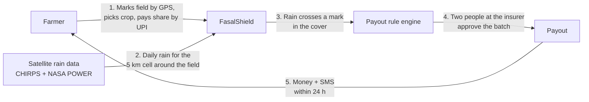
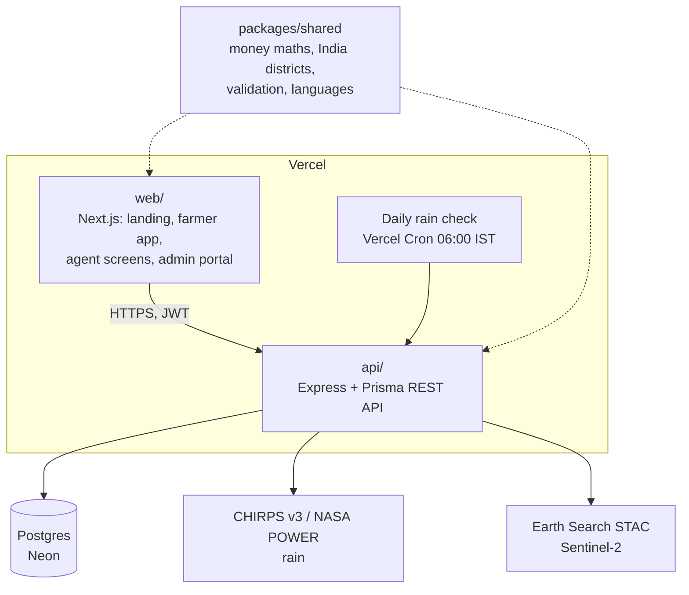

# FasalShield

**Crop cover that pays when the rain fails.**

FasalShield is parametric crop insurance for smallholder farmers across India. A satellite measures the rain on each farmer's field every day. When the rain falls below (or above) a mark written into the cover, money goes to the farmer's UPI ID within 24 hours, automatically. No claim forms, no field visits, no proof.

|            |                                                                                                                                           |
| ---------- | ----------------------------------------------------------------------------------------------------------------------------------------- |
| **Try it** | https://fasal-app-nps2.vercel.app (farmer app and landing page)                                                                           |
| **API**    | https://fasal-app-pi.vercel.app/health                                                                                                    |
| **Status** | Working demo. All screens work end to end with test money. Real insurance, payments and SMS switch on once the partners below are signed. |

> **Demo notice.** The live site is a pilot. Covers are for demonstration only; no real insurance is issued and no real money moves. Sign in with any 10-digit number starting 6–9. The test code is shown on screen.

---

## How it works



1. **The farmer adds their field.** Stand in the field, tap _Use my location_, choose the crop and acres. Optional survey/khasra number from the land record.
2. **They pick a cover and pay their share by UPI.** Before paying they see exactly which rain level pays how much. A sponsor or government share is shown separately.
3. **Rain is measured every day** for the 5 km grid cell the field sits in, and compared with that cell's own normal rain.
4. **When rain crosses a mark** in a phase (sowing, growth, grain filling), that phase pays its share: for example 25% at 40% below normal, 60% at 60% below, 100% at 80% below. A higher mark later pays only the difference. The whole season never pays more than the cover.
5. **Money moves only after two people approve it**, then reaches the farmer's checked UPI ID with an SMS showing the rain measured.

---

## What's built

### Farmer app (mobile-first website, installable like an app)

- Opening animation, three welcome cards, plain-language terms before starting
- Phone + SMS code sign-in (code shown on screen in the demo)
- About you → mark your field on a map (GPS accuracy checks, duplicate-field checks) → UPI ID with bank-name check
- Season-aware crop list (Rabi: wheat, gram, jowar · Kharif: soybean, cotton, tur, jowar)
- Two covers: **Dry Spell Cover** and **Heavy Rain Cover**, priced for the farmer's acres
- Home with a live **rain meter** against the payout marks; policy page with phases, rain so far and payouts
- Messages, complaints with a 14-day answer promise, payout rules worked out on the farmer's own cover
- Works on 2G: offline screen, cached assets, nothing heavy on first load

### Field agent / FPO screens

Agents enrol farmers in the field (consent read aloud in the farmer's language, GPS pin, UPI check). The farmer then signs in on their own phone and pays from their own UPI. Agents never handle money and see only their own farmers. A disabled agent is signed out at once.

### Admin portal

Dashboard · payouts (submit and approve as separate people) · trigger events with tamper-evident evidence · products and versions (second person publishes) · farmers and policies · complaints · land checks with a **Sentinel-2 satellite crop check** at each field pin · rain data and weather simulator · field agents · staff and roles · audit log.

### 13 languages

English, हिन्दी, বাংলা, తెలుగు, मराठी, தமிழ், ગુજરાતી, ಕನ್ನಡ, മലയാളം, ଓଡ଼ିଆ, ਪੰਜਾਬੀ, অসমীয়া and اردو (right to left). Every farmer screen, the landing page and the terms, privacy and complaints pages are translated. Missing strings fall back to English, never a blank. The translation check (`npm test -w web`) fails if any language loses a key, a `{placeholder}` or a `[BRACKETED]` legal item.

### Readiness

| Part                                                                       | State                                                                         |
| -------------------------------------------------------------------------- | ----------------------------------------------------------------------------- |
| Farmer app, field agent screens, admin portal                              | Done                                                                          |
| Real satellite rain (CHIRPS final + NASA POWER early) and per-cell normals | Done                                                                          |
| Satellite crop check (Sentinel-2 NDVI)                                     | Done                                                                          |
| 13 languages                                                               | Done; translations need review by native speakers                             |
| Uptime monitoring                                                          | Done (GitHub Actions, every 30 min)                                           |
| Payments (UPI premium and payouts)                                         | **Demo**: needs a payment provider                                            |
| SMS sign-in codes                                                          | **Demo**: needs an SMS provider                                               |
| Insurance                                                                  | **Demo**: needs an IRDAI-registered insurer; fills the `[INSURER NAME]` items |
| Production hosting in India                                                | Pending                                                                       |
| Flutter Android app (`mobile/`)                                            | Early; the website already installs on phones                                 |

---

## Architecture



- **Payment, SMS and KYC sit behind adapters** in `api/src/adapters/`. Today they are mocks; connecting a real provider means writing one adapter, not changing the app.
- **Payout rules** live in `api/src/rules/` and are covered by tests. Products are versioned; a published version is locked.

### Tech stack

Next.js 15 · React 19 · TypeScript · Express · Prisma · PostgreSQL · Leaflet · Turborepo · Jest · Vercel · Flutter (mobile, early)

---

## Repository layout

| Folder                                 | What it is                                                                                                                                                           |
| -------------------------------------- | -------------------------------------------------------------------------------------------------------------------------------------------------------------------- |
| [`web/`](web/)                         | Next.js website: landing page (`public/welcome/`), farmer app, field agent screens, admin portal (`src/app/admin/`)                                                  |
| [`api/`](api/)                         | Express + Prisma API: `src/modules/` routes per area, `src/rules/` payout engine, `src/adapters/` rain, satellite, SMS, payments, `prisma/` schema, migrations, seed |
| [`packages/shared/`](packages/shared/) | Code used by both: money maths, India districts and grid, validation, language list, env checks                                                                      |
| [`mobile/`](mobile/)                   | Flutter Android app (early)                                                                                                                                          |
| [`docs/`](docs/README.md)              | Product requirements (also as PDF), technical architecture, security and access, frontend spec, feature tickets                                                      |
| [`DEPLOY.md`](DEPLOY.md)               | Step-by-step Vercel + Neon deployment                                                                                                                                |

Inside `web/src/`: `app/` screens, `components/` shared pieces, `i18n/` app translations, `legal/` terms, privacy and complaints text per language, `lib/` sessions, API calls, formatting.

---

## Run it locally

**Needs:** Node.js 22 or newer, npm 10 or newer.

```bash
cp .env.example .env          # replace every "replace-with-..." secret
npm install
npm run build                 # builds packages/shared

# database (embedded Postgres, no Docker needed)
npm run db:start  -w api      # leave running in its own terminal
npm run db:migrate -w api
npm run db:seed    -w api     # crops, seasons, covers, demo data

# servers
npm run dev -w api
npm run dev -w web            # http://localhost:3000
```

Create a staff account for the admin portal with `npm run staff:create -w api`.

### Checks

| Command                       | Does                                                             |
| ----------------------------- | ---------------------------------------------------------------- |
| `npm run check`               | Everything to run before pushing: format, lint, typecheck, tests |
| `npm test -w api`             | API tests (payout rules, satellite maths, auth)                  |
| `npm test -w packages/shared` | Shared tests (money, validation, roles, geo)                     |
| `npm test -w web`             | Translation check across all 13 languages                        |

Every push to `main` redeploys both Vercel projects. See [`DEPLOY.md`](DEPLOY.md).

---

## Security

Designed so that no single person, and no stolen password, can move money or read farmers' data unseen.

- **Two-person rule for money.** Claims ops submits a payout batch; a different person approves it with a fresh code. New product versions also need a second person.
- **Staff sign-in** with password plus an authenticator-app code; roles limit every screen and action (main admin, product manager, claims ops, payout approver, reinsurer, regulator).
- **Farmer data:** sensitive fields are encrypted at rest; phone numbers are masked for staff; every time someone opens a farmer's record it is logged.
- **Tamper-evident audit log**: entries are hash-chained, so any change is detectable. Trigger evidence carries its own hash checks.
- **Sign-in codes** are stored only as keyed hashes, expire, and are rate-limited; repeated wrong codes lock the attempt.
- **Web hardening:** strict Content-Security-Policy, HSTS, frame blocking and other security headers; sessions in HttpOnly cookies; role checks enforced on the API, not only in the browser.
- **Secrets** live only in environment settings; `.env*` files are never committed.
- **Uptime:** a GitHub Action checks the API, database and sign-in page every 30 minutes and opens an issue if anything is down.

Before real money moves, an independent security test and a legal review of the translated terms are recommended.

Found a security problem? Please report it privately to the maintainers rather than opening a public issue.

---

## Before going live

These need contracts or paid accounts, not code. Each connects through an existing adapter or placeholder:

1. **Insurer partnership** (IRDAI-registered): fills `[INSURER NAME]`, `[IRDAI REG. NO.]` and grievance contacts in the legal pages.
2. **Payment provider** for UPI premium collection and payouts.
3. **SMS provider** for real sign-in codes and payout messages.
4. **Production hosting in India** for data residency, as the privacy policy promises.
5. **Grievance officer**: a named person and phone number.
6. **Translation review** by native speakers, especially the legal pages.

---

## Data and media credits

- Rain: [CHIRPS](https://www.chc.ucsb.edu/data/chirps3) (Climate Hazards Center, UC Santa Barbara) and [NASA POWER](https://power.larc.nasa.gov/).
- Satellite imagery: [Copernicus Sentinel-2](https://sentinels.copernicus.eu/) via [Earth Search](https://earth-search.aws.element84.com/v1) (Element 84).
- Maps: © [OpenStreetMap](https://www.openstreetmap.org/copyright) contributors.
- Landing-page footage and photos: Wikimedia Commons, credited individually in the page footer.

## Licence

Not open source. All rights reserved by the FasalShield owners; please ask before reusing any part.
