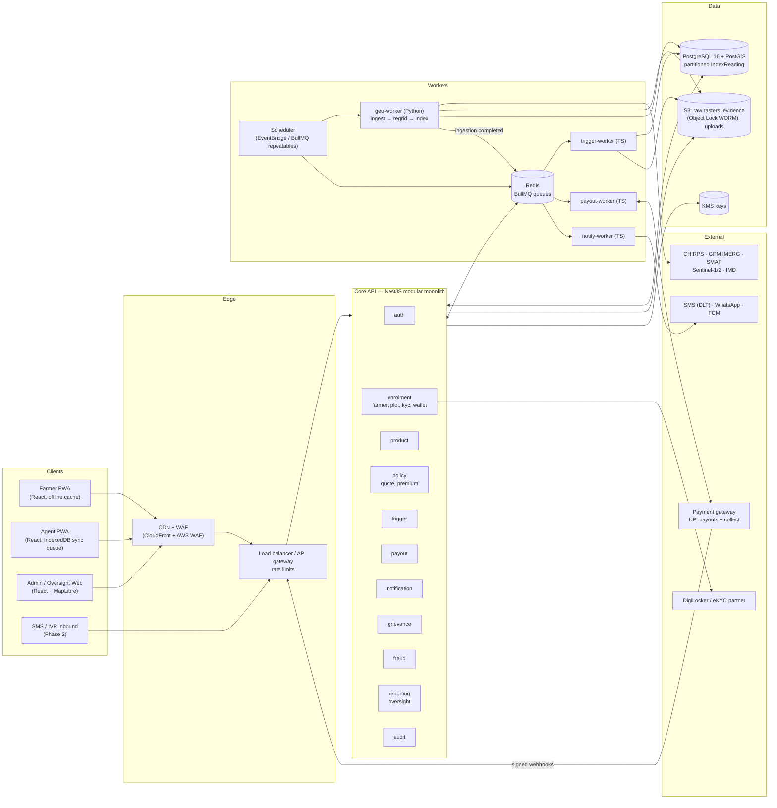
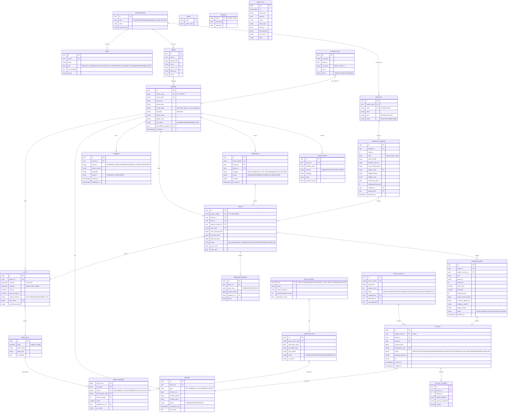
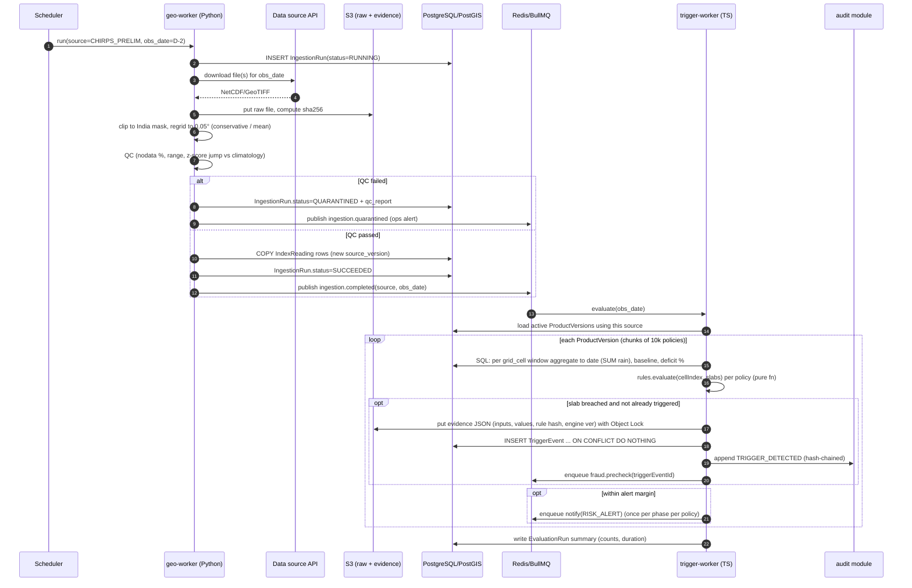
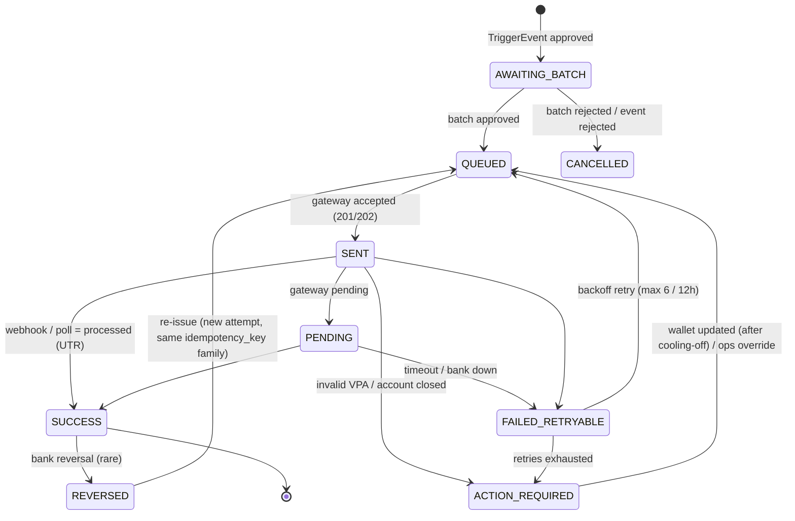

# 2. Technical Architecture Document — FasalShield

| Field | Value |
|-------|-------|
| Version | 0.1 (pre-build draft) |
| Implements | [PRD](01-PRD.md) FR-01…FR-46, NFR-01…NFR-17 |
| Status | The proposed stack needs confirmation (see the Ready-to-Build checklist) |

---

## 1. Architecture principles

1. **Modular monolith first.** One deployable API with strict module boundaries, plus separate workers. Each module owns its tables. Modules can be split into services later without a rewrite.
2. **Deterministic, versioned decisions.** Trigger evaluation is a pure function of (`ProductVersion` rules, `IndexReading` values, engine version). Every decision stores its inputs.
3. **Idempotent everywhere.** Client-generated UUIDs for offline sync, unique constraints for trigger slabs, idempotency keys for payouts and gateway reference IDs.
4. **Provider interfaces.** `PaymentProvider`, `MessagingProvider`, `KycProvider` and `DataSourceConnector` each have a mock or sandbox implementation, so the demo runs end-to-end without third parties (PRD §8).
5. **Geo work in Python, business logic in TypeScript.** Raster and NetCDF tooling (xarray, rasterio) is mature in Python. Business rules, APIs and payouts live in one typed codebase.
6. **India data residency** (NFR-17). All PII and payment data stays in ap-south-1.

## 2. High-level system diagram



## 3. Component breakdown

| Component | Responsibility | Key FRs | Tech |
|-----------|---------------|---------|------|
| `auth` module | OTP issue and verify, JWT access and refresh, device binding, staff login + TOTP/WebAuthn MFA, step-up MFA | FR-01, FR-42 | NestJS, `otplib`, `@simplewebauthn/server` |
| `enrolment` module | Farmer, Plot, KYC, Wallet, Consent, bulk CSV import, agent sync endpoint | FR-02…FR-09 | NestJS, PostGIS |
| `product` module | Product builder, `ProductVersion` publishing (four-eyes, hash), rule JSON schema validation, backtest jobs | FR-11, FR-12, FR-16 | Zod / JSON Schema shared package |
| `policy` module | Quote, premium payment, policy issuance, certificate PDF, waiting period | FR-13…FR-15, FR-43 | `pdfkit` (or a headless template renderer) |
| `trigger` module + `trigger-worker` | Policy evaluation, `TriggerEvent` creation, evidence snapshot, routing, risk alerts | FR-22…FR-26 | TS rule engine (pure functions), SQL window aggregates |
| `geo-worker` | Connectors, download, regrid to 0.05°, QC, compute per-cell daily metrics, write `IndexReading`, simulator | FR-17…FR-21 | Python 3.12, xarray, rioxarray, rasterio, numpy, `earthaccess` (NASA), Copernicus Data Space API / GEE (optional) |
| `payout` module + `payout-worker` | Batching, maker-checker, disbursement, retries, webhooks, reconciliation, SLA timers | FR-27…FR-32 | BullMQ, provider adapters |
| `notification` module + `notify-worker` | Templates per language, channel fallback, delivery receipts | FR-33, FR-34 | ICU MessageFormat, provider adapters |
| `fraud` module | Rule-based checks at enrolment and pre-payout, flags queue | FR-38 | SQL + PostGIS rules |
| `grievance` module | Ticketing, SLA, evidence attachments, outcomes | FR-44, FR-45 | — |
| `reporting` module | Dashboards (materialised views), exports, oversight scoping | FR-35, FR-36, FR-40, FR-41 | PG materialised views, refreshed every 15 min |
| `audit` module | Append-only hash-chained `AuditLog`, verification endpoint | FR-39, NFR-11 | PG + S3 WORM daily anchor |
| Farmer PWA | Farmer journeys | See Frontend Spec | React 18, Vite, Workbox, Leaflet (lazy) |
| Agent PWA | Assisted and offline enrolment | See Frontend Spec | Same stack + Dexie (IndexedDB) |
| Admin web | Product builder, maps, queues, oversight | See Frontend Spec | React 18, Vite, TanStack Query/Table, MapLibre GL, shadcn/ui |

## 4. Recommended tech stack

| Layer | Choice | Why | Alternatives considered |
|-------|--------|-----|------------------------|
| Language | **TypeScript** end-to-end (except geo) | One language for API, workers and 3 frontends. Shared types and validation schemas (Zod) between the product builder UI and the rule engine. | Go (faster, but slower team velocity), Python everywhere (weaker frontend sharing) |
| Monorepo | **pnpm + Turborepo** | `apps/farmer`, `apps/agent`, `apps/admin`, `apps/api`, `services/geo-worker`, `packages/{rules,ui,i18n,types}` | Nx |
| Farmer / Agent app | **React PWA** (Vite + Workbox), Leaflet lazy-loaded | Smallest install friction (open link → "Add to home screen"), no Play Store review, updates instantly, fits the 150 KB budget. **Phase 2:** wrap in a Trusted Web Activity / Capacitor for Play Integrity, mock-location detection and background sync reliability. | React Native / Expo: better native access, but a heavier install (25–40 MB) and store releases. Revisit if GPS spoofing becomes material. |
| Admin web | **React + Vite + TanStack Query + shadcn/ui (Radix + Tailwind)**, MapLibre GL | Rich tables and maps. Desktop-first. | Next.js (SSR not needed for an authenticated admin) |
| API | **NestJS (Node 22 LTS)** | Modules, DI, guards for RBAC, OpenAPI generation, mature ecosystem | Fastify bare, Express |
| ORM / SQL | **Drizzle ORM** + raw SQL for PostGIS and window aggregates | Typed, thin, SQL-first (geo queries need raw SQL) | Prisma (weaker PostGIS support) |
| Database | **PostgreSQL 16 + PostGIS 3.4** (AWS RDS) | Geo joins (plot → cell), JSONB for rules, strong constraints for idempotency, partitioning for `IndexReading` | TimescaleDB extension (an option if `IndexReading` exceeds ~2B rows); Mongo (rejected: weak constraints) |
| Queue / scheduler | **Redis 7 + BullMQ** (ElastiCache) | Retries with backoff, delayed jobs (SLA timers), repeatable jobs, rate limiting for gateway calls | Temporal (better for long workflows; consider in Phase 3), SQS |
| Geo pipeline | **Python 3.12**: xarray, rioxarray, rasterio, numpy, `earthaccess`, `sentinelhub`/CDSE, optional Google Earth Engine | Industry standard for NetCDF/GeoTIFF. GEE removes heavy SAR/NDVI processing (check its licensing for commercial use). | GDAL CLI scripts |
| Object storage | **S3** with **Object Lock (compliance mode)** for the evidence bucket | Tamper-evident evidence (NFR-11) | — |
| Cloud | **AWS ap-south-1 (Mumbai)**, DR snapshots in ap-south-2 (Hyderabad) | India residency (NFR-17), managed PG/Redis, KMS | GCP Mumbai / Delhi (closer to GEE), Azure Pune |
| Compute | **ECS Fargate** (API, workers), Fargate scheduled tasks for geo-worker | No cluster to run. Scales workers on queue depth. | EKS (later, if the team has K8s skills) |
| IaC / CI | Terraform, GitHub Actions, Docker | — | CDK |
| Observability | OpenTelemetry → Grafana Cloud (or AWS CloudWatch + X-Ray), Sentry for frontend and API errors | — | Datadog |
| Local dev | `docker compose` (Postgres+PostGIS, Redis, MinIO, Mailpit-style SMS sink, mock gateway) | The demo runs offline from the internet | — |

## 5. Data model

### 5.1 ERD



### 5.2 Key modelling decisions

| Decision | Detail |
|----------|--------|
| Money | `bigint` paise everywhere. Rates are in basis points (`premium_rate_bp`, `payout_pct_bp`). |
| `IndexReading` partitioning | Range-partitioned by month on `obs_date`. PK `(grid_cell_id, obs_date, metric, data_source_code, source_version)`. India has ~130k land cells at 0.05°, so a year of 3 metrics is ~140M rows. That is fine for PG with partitions; TimescaleDB is an option later. |
| Revisions | A new `source_version` is inserted and never updated. Triggers record exactly which versions they used. |
| Trigger idempotency | `UNIQUE (policy_id, product_version_id, phase_id, slab_level)` on `TRIGGER_EVENT`. |
| Payout idempotency | `UNIQUE (trigger_event_id)` on `PAYOUT`. `idempotency_key = sha256(trigger_event_id)` is sent to the gateway as its reference ID. |
| Cumulative cap | `POLICY.paid_out_paise` is updated in the same transaction that marks a payout `SUCCESS`, with `CHECK (paid_out_paise <= sum_insured_paise)`. Slab top-up amount = `slab_pct × SI − already_paid_for(phase)`. |
| PII | `name_enc`, `handle_enc` use envelope encryption (KMS data key). `phone_hash` and `id_doc_hash` are HMAC-SHA256 with a secret pepper, for dedup without storing raw identifiers. Phone is stored in plain E.164 because it is the login identifier and is needed for SMS. Access is restricted (see Security §4). |
| Geo | SRID 4326 storage, `GIST` indexes on `centroid`, `boundary`, `geom`. Plot → cell: `ST_Contains(grid_cell.geom, plot.centroid)`. |

### 5.3 Product rule schema (`ProductVersion.rules`, shared `packages/rules`)

```json
{
  "schema": "fasalshield.rules/v1",
  "index": {
    "type": "DROUGHT_RAIN_DEFICIT",
    "metric": "RAIN_MM",
    "sources": ["CHIRPS_PRELIM", "IMERG_EARLY"],
    "sourcePolicy": "PRIMARY_THEN_FALLBACK",
    "baseline": { "kind": "LONG_TERM_MEAN", "years": "1991-2020" }
  },
  "phases": [
    { "id": "P1_SOWING",   "from": "2026-06-15", "to": "2026-07-15", "aggregation": "SUM", "weightPct": 30 },
    { "id": "P2_VEG",      "from": "2026-07-16", "to": "2026-08-31", "aggregation": "SUM", "weightPct": 40 },
    { "id": "P3_FLOWER",   "from": "2026-09-01", "to": "2026-09-30", "aggregation": "SUM", "weightPct": 30 }
  ],
  "slabs": [
    { "level": 1, "op": "GTE", "threshold": 40, "unit": "PCT_DEFICIT", "payoutPctOfPhase": 25 },
    { "level": 2, "op": "GTE", "threshold": 60, "unit": "PCT_DEFICIT", "payoutPctOfPhase": 60 },
    { "level": 3, "op": "GTE", "threshold": 80, "unit": "PCT_DEFICIT", "payoutPctOfPhase": 100 }
  ],
  "evaluation": { "mode": "TO_DATE", "earlyTrigger": true },
  "alerts": { "marginPct": 10 }
}
```

The phase payout is `SI × phase.weightPct × slab.payoutPctOfPhase`. With `earlyTrigger: true`, a deficit evaluated to date may trigger before the phase ends. This requires deficit-to-date against the pro-rated baseline, which is only possible because rainfall can't be "un-fallen". Flood products use `FLOOD_EXCESS_RAIN` (rolling 3-day sum ≥ X mm) or `FLOOD_SAR_EXTENT` (flooded fraction of the cell ≥ Y%).

## 6. Satellite data ingestion and trigger-evaluation pipeline

### 6.1 Source catalogue (for planning; verify latency and licence before committing)

| `DataSource.code` | Product | Native resolution | Typical latency | Use | Phase |
|---|---|---|---|---|---|
| `SIMULATOR` | Synthetic | 0.05° | Instant | Demo, tests | MVP |
| `IMERG_EARLY` | NASA GPM IMERG Early Run | 0.1° daily / 30-min | ~4h | Fast rainfall triggers, flood | MVP (one of) |
| `CHIRPS_PRELIM` | CHIRPS preliminary | 0.05° pentad/daily | ~2 days (final ~3 weeks) | Drought deficit | MVP (one of) |
| `IMD` | IMD gridded rainfall | 0.25° daily | ~1 day (access by agreement) | India validation / primary | Phase 2 |
| `SMAP_L4` | NASA SMAP L4 soil moisture | 9 km | ~2–3 days | Agricultural drought | Phase 2 |
| `S2_NDVI` | Sentinel-2 L2A NDVI | 10–20 m (aggregated to cell) | 5-day revisit + cloud | Vegetation stress | Phase 2 |
| `S1_SAR` | Sentinel-1 GRD flood mapping | 10 m (aggregated to flood fraction) | 6–12-day revisit | Flood extent | Phase 2 |

### 6.2 Sequence: ingestion → index → trigger



**Performance:** the engine aggregates **per grid cell** first (~130k cells) and then fans out to policies by `grid_cell_id`. Cost scales with the number of cells rather than policies, which meets NFR-08 (3M policies in ≤ 2h).

**Evidence snapshot** (`s3://fs-evidence/{yyyy}/{mm}/{triggerEventId}.json`):

```json
{
  "triggerEventId": "…", "policyNumber": "FS-P-26K-000123", "gridCellId": 412233,
  "productVersionId": "…", "rulesSha256": "…", "engineVersion": "trigger@1.4.2+git.abc123",
  "phase": "P2_VEG", "window": ["2026-07-16", "2026-08-20"],
  "readings": [{"obs_date": "2026-07-16", "value": 3.2, "source": "CHIRPS_PRELIM", "source_version": 1, "ingestionRunId": "…", "rawSha256": "…"}],
  "aggregate": {"observedMm": 142.1, "baselineMm": 301.0, "deficitPct": 52.8},
  "slab": {"level": 1, "threshold": 40, "payoutPctOfPhase": 25},
  "payoutAmountPaise": 150000, "detectedAt": "2026-08-22T03:14:00Z"
}
```

## 7. Payout flow (end to end)

### 7.1 State machine



### 7.2 Sequence

```mermaid
sequenceDiagram
  autonumber
  participant TW as trigger-worker
  participant FR as fraud module
  participant PAY as payout module
  participant OPS as CLAIMS_OPS (maker)
  participant APR as PAYOUT_APPROVER (checker)
  participant PW as payout-worker
  participant GW as Payment gateway
  participant N as notify-worker
  participant F as Farmer

  TW->>FR: precheck(triggerEventId)
  FR-->>PAY: CLEAN or FLAGGED(reasons)
  alt FLAGGED
    PAY->>PAY: TriggerEvent.status=HELD → fraud queue
  else CLEAN
    PAY->>PAY: TriggerEvent.status=APPROVED, create Payout(AWAITING_BATCH, sla_due_at=detected_at+24h)
  end
  Note over PAY: Hourly (or ≥500 items): build PayoutBatch per product+state
  alt batch ≤ auto-approval limits and no flags
    PAY->>PAY: auto-approve (system actor), audit log
  else needs human
    OPS->>PAY: review batch + evidence → SUBMIT
    APR->>PAY: APPROVE (step-up MFA, approver ≠ submitter)
  end
  PAY->>PW: enqueue disburse(payoutId) × N (rate-limited)
  PW->>PW: SELECT ... FOR UPDATE SKIP LOCKED; skip if status ∉ {QUEUED}
  PW->>GW: POST /payouts {reference_id=idempotency_key, amount, vpa} + Idempotency-Key header
  alt network timeout / 5xx
    PW->>GW: GET /payouts?reference_id=… (status lookup before any retry)
  end
  GW-->>PW: accepted (gateway_payout_id) → status SENT
  GW-->>PAY: webhook payout.processed (HMAC-signed)
  PAY->>PAY: verify signature + timestamp, dedupe by event id
  PAY->>PAY: TX: Payout=SUCCESS, credited_at, utr; Policy.paid_out += amount; TriggerEvent=PAID; audit
  PAY->>N: notify(PAYOUT_SENT)
  N->>F: SMS/WhatsApp/push in farmer's language
  Note over PAY,GW: Reconciliation job (hourly + daily settlement file): match by reference_id, flag mismatches (amount, status, missing)
  Note over PAY: SLA job: alert at detected_at+12h, +20h; breach metric at +24h
```

### 7.3 Idempotency, retry and reconciliation rules

| Concern | Rule |
|---------|------|
| Duplicate trigger | DB unique `(policy_id, product_version_id, phase_id, slab_level)` |
| Duplicate payout | DB unique `payout.trigger_event_id`. Gateway `reference_id = idempotency_key`. Worker claims the row with `FOR UPDATE SKIP LOCKED` and moves it `QUEUED → SENT` atomically before the call (an outbox-style "intent" record in `PayoutAttempt`). |
| Unknown outcome (timeout) | **Never resend blindly.** Look up status by `reference_id` first, and only re-POST if the gateway reports not-found. |
| Retry schedule | 1m, 5m, 15m, 1h, 3h, 6h (max 6 attempts within 12h so the SLA can still be met). Only for retryable codes (timeouts, 5xx, `BANK_DOWN`, rate-limit). |
| Non-retryable | `INVALID_VPA`, `ACCOUNT_CLOSED`, `NAME_MISMATCH` → `ACTION_REQUIRED`, notify the farmer and their agent, and show it in the ops queue. |
| Webhooks | HMAC-SHA256 signature + timestamp (±5 min) + event-id dedupe table. Processed in order per payout using `updated_at` monotonicity. |
| Reconciliation | Hourly: poll all `SENT`/`PENDING` older than 15 min. Daily: ingest the gateway settlement report, then three-way match (Payout ↔ gateway ↔ bank statement). Mismatch → `FraudFlag`/ops ticket of type `RECON_MISMATCH`. |
| Funding | Pre-check payout account balance before releasing a batch, and alert insurer finance if the balance is below the batch total × 1.2. |

## 8. API design (REST, `/api/v1`)

Conventions: JSON, `Authorization: Bearer <JWT>`, `Idempotency-Key` header on all POSTs that create money or records from offline clients, cursor pagination (`?cursor=&limit=`), errors as RFC 9457 `application/problem+json`, OpenAPI 3.1 generated from NestJS decorators. "Scope" means data the role can see (own / org / assigned / all).

### 8.1 Auth
| Method | Path | Request → Response | Roles |
|---|---|---|---|
| POST | `/auth/otp/request` | `{phone, purpose:"LOGIN"}` → `{requestId, expiresIn}` | Public (rate-limited) |
| POST | `/auth/otp/verify` | `{requestId, otp, deviceId}` → `{accessToken, refreshToken, user:{id, role, isNew}}` | Public |
| POST | `/auth/refresh` | `{refreshToken}` → new token pair (rotation) | Any |
| POST | `/auth/logout` | — → 204 | Any |
| POST | `/auth/staff/login` | `{email, password}` → `{mfaChallengeId}` | Staff |
| POST | `/auth/staff/mfa/verify` | `{mfaChallengeId, totp \| webauthnAssertion}` → tokens | Staff |
| POST | `/auth/step-up` | `{totp \| webauthnAssertion, action}` → `{stepUpToken (5 min)}` | `PAYOUT_APPROVER`, `SYS_ADMIN`, `PRODUCT_MANAGER` |
| POST | `/auth/agent/pin` | `{pin}` → 204 (set or verify offline-unlock PIN) | `AGENT` |

### 8.2 Farmer, consent, KYC, wallet
| Method | Path | Request → Response | Roles |
|---|---|---|---|
| GET | `/me` | → `{farmer, wallets[], kycStatus, language}` | `FARMER` (own) |
| PATCH | `/me` | `{name, language, villageCode}` → farmer | `FARMER` |
| POST | `/farmers` | `{clientId, phone, name, language, villageCode, consent:{…}}` → farmer (idempotent on `clientId`) | `AGENT`, `FPO_ADMIN` |
| GET | `/farmers?phone=&q=` | → page of farmers (masked PII) | `AGENT` (assigned), `FPO_ADMIN` (org), `CLAIMS_OPS`, `SYS_ADMIN` |
| GET | `/farmers/{id}` | → farmer detail | Scoped as above, `FARMER` (self) |
| POST | `/farmers/{id}/consents` | `{purpose, noticeVersion, language, channel, evidence}` → consent | `FARMER` (self), `AGENT` |
| DELETE | `/farmers/{id}/consents/{consentId}` | → 204 (withdraw) | `FARMER` (self) |
| POST | `/farmers/{id}/kyc` | multipart `{docType, docNumberLast4, image}` or `{provider:"DIGILOCKER", authCode}` → `{kycStatus}` | `FARMER` (self), `AGENT` |
| POST | `/farmers/{id}/wallets` | `{type:"UPI_VPA", handle}` → wallet `{status, verifiedName, handleMasked, coolingOffUntil}` | `FARMER` (self), `AGENT` |
| POST | `/farmers/{id}/wallets/{walletId}/primary` | → wallet | `FARMER` (self) (OTP re-confirm) |
| POST | `/farmers/bulk` | multipart CSV → `{importJobId}` | `FPO_ADMIN` |
| GET | `/imports/{importJobId}` | → `{status, created, errors[], errorReportUrl}` | `FPO_ADMIN` |
| POST | `/sync` | `{ops:[{clientId, type, payload, clientTs}]}` → `{results:[{clientId, status, serverId, error}]}` | `AGENT` |

### 8.3 Plots, catalogue
| Method | Path | Request → Response | Roles |
|---|---|---|---|
| POST | `/farmers/{id}/plots` | `{clientId, centroid:{lat,lng}, accuracyM, boundary?:GeoJSON, captureMethod, photoIds?}` → plot `{id, gridCellId, areaHa, flags[]}` | `FARMER` (self), `AGENT` |
| GET | `/farmers/{id}/plots` | → plots | Scoped |
| PATCH | `/plots/{plotId}` | `{boundary?, verificationStatus?}` → plot | `AGENT`, `CLAIMS_OPS` |
| GET | `/catalog/crops?district=` | → crops with i18n names and icons | Any authenticated |
| GET | `/catalog/seasons?state=` | → seasons | Any authenticated |

### 8.4 Products
| Method | Path | Request → Response | Roles |
|---|---|---|---|
| GET | `/products?status=` | → products | Staff; `FARMER`/`AGENT` see `ACTIVE` eligible only via `/quotes` |
| POST | `/products` | `{code, name, peril}` → product | `PRODUCT_MANAGER` |
| POST | `/products/{id}/versions` | `{rules, premiumRateBp, sumInsuredPaise, seasonCode, eligibleDistricts, eligibleCrops, enrolmentCutoff, waitingPeriodDays}` → draft version (schema-validated) | `PRODUCT_MANAGER` |
| PUT | `/products/{id}/versions/{v}` | same → draft (only while `DRAFT`) | `PRODUCT_MANAGER` |
| POST | `/products/{id}/versions/{v}/submit` | → `PENDING_APPROVAL` | `PRODUCT_MANAGER` |
| POST | `/products/{id}/versions/{v}/publish` | `X-Step-Up` → published version `{rulesSha256}` (publisher ≠ author) | `PRODUCT_MANAGER`, `SYS_ADMIN` |
| POST | `/products/{id}/versions/{v}/backtest` | `{years:[2000..2025], districts?}` → `{jobId}`; GET `/backtests/{jobId}` → stats | `PRODUCT_MANAGER` |

### 8.5 Quotes, policies, premiums
| Method | Path | Request → Response | Roles |
|---|---|---|---|
| POST | `/quotes` | `{plotId, cropCode, seasonCode}` → `[{productVersionId, premiumPaise, subsidyPaise, netPaise, sumInsuredPaise, examplePayouts[], explainerKey}]` | `FARMER`, `AGENT` |
| POST | `/policies` | `{clientId, quoteRef, productVersionId, plotId, cropCode, payer:"FARMER"\|"FPO"}` → policy `PENDING_PAYMENT` | `FARMER`, `AGENT`, `FPO_ADMIN` |
| GET | `/policies?farmerId=&status=` | → policies | Scoped |
| GET | `/policies/{id}` | → policy + phases + current index snapshot | Scoped |
| GET | `/policies/{id}/index` | → `{phases:[{id, observed, baseline, deficitPct, nextThreshold, status}], dataAsOf}` | Scoped |
| GET | `/policies/{id}/certificate` | → PDF | Scoped |
| POST | `/policies/{id}/premium-payments` | `{method:"UPI_INTENT"\|"UPI_COLLECT", vpa?}` → `{paymentId, upiIntentUrl \| collectStatus}` | `FARMER`, `AGENT` |
| POST | `/premium-payments/combined` | `{policyIds[]}` → `{paymentId, paymentLink}` | `FPO_ADMIN` |

### 8.6 Data, simulator, triggers
| Method | Path | Request → Response | Roles |
|---|---|---|---|
| GET | `/data-sources` | → sources + last run + freshness | Staff |
| GET | `/ingestion-runs?source=&status=` | → runs | `SYS_ADMIN`, `PRODUCT_MANAGER`, `CLAIMS_OPS` |
| POST | `/simulator/scenarios` | `{name, metric, districtCodes[] \| geojson, dateFrom, dateTo, mode:"PCT_OF_NORMAL"\|"ABSOLUTE", value}` → scenario + generated readings (**non-prod only**) | `SYS_ADMIN`, `PRODUCT_MANAGER` |
| POST | `/evaluations` | `{obsDate, productVersionIds?}` → `{evaluationRunId}` (manual re-run) | `SYS_ADMIN`, `CLAIMS_OPS` |
| GET | `/grid-cells/{id}/readings?metric=&from=&to=` | → time series | Staff, `REGULATOR`, `REINSURER` |
| GET | `/map/cells?bbox=&metric=&date=&productVersionId=` | → vector tiles / GeoJSON with index values | Staff, `REGULATOR`, `REINSURER` |
| GET | `/trigger-events?status=&district=&from=` | → events | Staff (scoped), `REGULATOR`, `REINSURER` (aggregated) |
| GET | `/trigger-events/{id}` | → event + evidence (signed URL) + verification `{evidenceHashValid}` | Staff, `REGULATOR`, `FARMER` (own, simplified) |
| POST | `/trigger-events/{id}/decision` | `{decision:"RELEASE"\|"REJECT", reason}` → event | `CLAIMS_OPS` |

### 8.7 Payouts
| Method | Path | Request → Response | Roles |
|---|---|---|---|
| GET | `/payout-batches?status=` | → batches | `CLAIMS_OPS`, `PAYOUT_APPROVER`, `SYS_ADMIN`, `REGULATOR` (read) |
| GET | `/payout-batches/{id}` | → batch + payouts + flags summary | Same |
| POST | `/payout-batches/{id}/submit` | `{note}` → `SUBMITTED` | `CLAIMS_OPS` |
| POST | `/payout-batches/{id}/approve` | `X-Step-Up`, `{note}` → `APPROVED` (approver ≠ submitter) | `PAYOUT_APPROVER` |
| POST | `/payout-batches/{id}/reject` | `{reason}` → `REJECTED` | `PAYOUT_APPROVER` |
| GET | `/payouts?farmerId=&status=` | → payouts | Scoped; `FARMER` own |
| POST | `/payouts/{id}/retry` | → `QUEUED` (only from `ACTION_REQUIRED`, after wallet fix) | `CLAIMS_OPS` |
| POST | `/webhooks/payments/{provider}` | Provider payload + signature → 200 | Provider (HMAC) |
| GET | `/reconciliation/runs` / `/reconciliation/mismatches` | → recon results | `CLAIMS_OPS`, `SYS_ADMIN` |
| GET | `/sla/payouts` | → `{p50, p95, breaches[], atRisk[]}` | Staff, `REGULATOR` |

### 8.8 Notifications, grievances, fraud, reporting, audit, admin
| Method | Path | Request → Response | Roles |
|---|---|---|---|
| GET | `/me/inbox` | → notifications (in-app) | `FARMER` |
| POST | `/webhooks/messaging/{provider}` | delivery receipts (signed) | Provider |
| POST | `/grievances` | `{policyId?, category, description?, voiceNoteId?, photoIds?}` → ticket | `FARMER`, `AGENT` |
| GET | `/grievances?status=` | → tickets | `FARMER` (own), `CLAIMS_OPS`, `REGULATOR` (stats) |
| POST | `/grievances/{id}/resolve` | `{outcome, explanationKey, note}` → ticket | `CLAIMS_OPS` |
| POST | `/uploads` | `{contentType, purpose}` → `{uploadId, presignedPutUrl}` (photos, voice) | Authenticated |
| GET | `/fraud-flags?status=` | → flags | `CLAIMS_OPS`, `SYS_ADMIN` |
| POST | `/fraud-flags/{id}/resolve` | `{status:"CLEARED"\|"CONFIRMED", note}` → flag | `CLAIMS_OPS` |
| GET | `/reports/portfolio?groupBy=district\|product\|peril&season=` | → exposure, premium, claims, loss ratio | Staff, `REINSURER`, `REGULATOR` |
| POST | `/reports/exports` | `{reportType, filters, format}` → `{exportId}` (audited) | Staff, `REGULATOR`, `REINSURER` |
| GET | `/audit-logs?entityType=&entityId=&actorId=` | → entries | `SYS_ADMIN`, `REGULATOR` |
| GET | `/audit-logs/verify?from=&to=` | → `{valid, brokenAtSeq?}` | `SYS_ADMIN`, `REGULATOR` |
| GET/POST/PATCH | `/admin/users`, `/admin/users/{id}` | staff CRUD, role assign (cannot self-assign) | `SYS_ADMIN` |
| GET | `/agents/me/dashboard` | → counts, pending sync, payouts to farmers | `AGENT` |

## 9. Third-party integrations

| Integration | MVP (demo) | Pilot / production candidates | Notes |
|---|---|---|---|
| Satellite and weather | `SIMULATOR` + one of CHIRPS-prelim / IMERG Early | NASA Earthdata (IMERG, SMAP) via `earthaccess`, CHIRPS (UCSB CHC), Copernicus Data Space (Sentinel-1/2), Google Earth Engine, IMD gridded data | Check licences (GEE commercial terms, IMD data-sharing agreement) |
| Payout (disbursement) | `MockPaymentProvider` (configurable delays and failures) | Razorpay X Payouts, Cashfree Payouts, a bank's corporate API (UPI/IMPS) | Needs a current/escrow account owned by the insurer; check UPI per-transaction limits |
| Premium collection | Mock UPI intent page | Razorpay / Cashfree / PayU (licensed PAs) UPI intent, collect, payment links | Premium flows to the insurer per IRDAI rules (verify) |
| VPA validation | Mock | Gateway "fund account validation" / UPI name lookup | Done at wallet link |
| SMS | `ConsoleMessagingProvider` | MSG91, Gupshup, Kaleyra | **TRAI DLT** registration of sender ID + templates is mandatory in India |
| WhatsApp | Mock | Meta WhatsApp Cloud API, Gupshup, Twilio | Template approval per language |
| Push | — | Firebase Cloud Messaging (web push) | — |
| IVR (Phase 2) | — | Exotel, Knowlarity | Missed-call and voice status |
| KYC | `MockKycProvider` | DigiLocker (via an authorised partner), Aadhaar offline e-KYC XML, Signzy, IDfy | Never store raw Aadhaar numbers (Security §4) |
| Maps | OSM tiles (dev only) | MapTiler / Stadia / self-hosted tiles (respect OSM tile usage policy), Esri / Sentinel-2 imagery for satellite base layer | India boundary depiction must follow Survey of India-compliant data |
| Other countries | — | M-Pesa Daraja B2C, MTN MoMo, Africa's Talking (SMS) | Via `PaymentProvider` / `MessagingProvider` |

**Provider interfaces** (`packages/types`): `PaymentProvider { createPayout(), getPayoutByReference(), verifyWebhook(), createCollect() }`, `MessagingProvider { send(), verifyReceipt() }`, `KycProvider { start(), complete() }`, `DataSourceConnector { fetch(obsDate), toGrid() }`.

## 10. Scalability

| Concern | Approach |
|---|---|
| API | Stateless containers behind ALB, autoscaling on CPU/RPS. Read replicas for reporting. |
| Evaluation | Cell-first aggregation (§6.2). Chunked fan-out by `grid_cell_id` across N trigger-worker replicas. |
| Payout burst | BullMQ with a rate limiter matched to the gateway's TPS limit (e.g. 50/s). 200k payouts ≈ 67 min at 50/s, well inside the SLA. |
| IndexReading growth | Monthly partitions; archive partitions older than 3 years to S3 Parquet (Athena for backtests). |
| Reporting | Materialised views refreshed every 15 min; heavy exports run async. |
| Static assets | CDN, immutable hashed bundles, service-worker precache. |

## 11. Observability

| Signal | Detail |
|---|---|
| Logs | JSON structured (pino / structlog), with `traceId`, `actorId` and `entityId`. PII redaction middleware (phone masked, names dropped). Retained 180 days in India (CERT-In, see Security §5). |
| Traces | OpenTelemetry across API → queue → workers → gateway calls. |
| Metrics (key) | `ingestion_freshness_hours{source}`, `evaluation_duration_seconds`, `trigger_events_total{peril,status}`, `payout_latency_seconds` (histogram), `payout_status_total{status,code}`, `gateway_errors_total`, `sla_at_risk_count`, `notification_delivery_ratio{channel}`, `sync_conflicts_total`, `otp_requests_total{result}` |
| Alerts (P1 page) | Ingestion freshness > expected latency + 12h; evaluation not finished by 06:00 IST; any payout `sla_at_risk` (20h); gateway error rate > 5% / 10 min; webhook signature failures > 0; audit chain verification failure; payout account balance low. |
| Dashboards | Pipeline health, Payout SLA, Business KPIs (M-01…M-11), Security (OTP abuse, login failures). |

## 12. Deployment and environments

| Env | Purpose | Data | Providers |
|---|---|---|---|
| `local` | Dev on laptop via `docker compose` | Seed + simulator | All mocks |
| `dev` | Integration, every merge to `main` | Synthetic | Mocks + sandbox gateways |
| `staging` / `demo` | UAT, hackathon demo, pen-test | Synthetic + anonymised | Sandbox gateways, real SMS to allowlisted numbers |
| `prod` | Pilot | Real | Live providers. **`SIMULATOR` source and simulator endpoints disabled by config + DB `allowed_in_prod=false`.** |

- **CI/CD:** GitHub Actions runs lint, type-check, unit tests, rule-engine golden tests and the OpenAPI diff, builds Docker images, applies Terraform plans, runs DB migrations (Drizzle) as a gated step and deploys to ECS. Prod deploys need manual approval.
- **Secrets:** AWS Secrets Manager; no secrets in env files committed to git.
- **Feature flags:** per-env config table (e.g. `enableWhatsApp`, `autoApproveLimitPaise`).
- **Repo layout:**
```
apps/
  api/              NestJS (modules: auth, enrolment, product, policy, trigger, payout, notification, grievance, fraud, reporting, audit)
  workers/          trigger-worker, payout-worker, notify-worker (same codebase, different entrypoints)
  farmer/           React PWA
  agent/            React PWA
  admin/            React web (also serves REGULATOR/REINSURER read-only views)
services/
  geo-worker/       Python package + Dockerfile
packages/
  rules/            rule schema (Zod) + pure evaluator + golden tests
  types/            shared DTOs, provider interfaces
  ui/               design tokens + shared components
  i18n/             message catalogues (en, hi, mr, te)
infra/              Terraform
docs/               this pack
```
