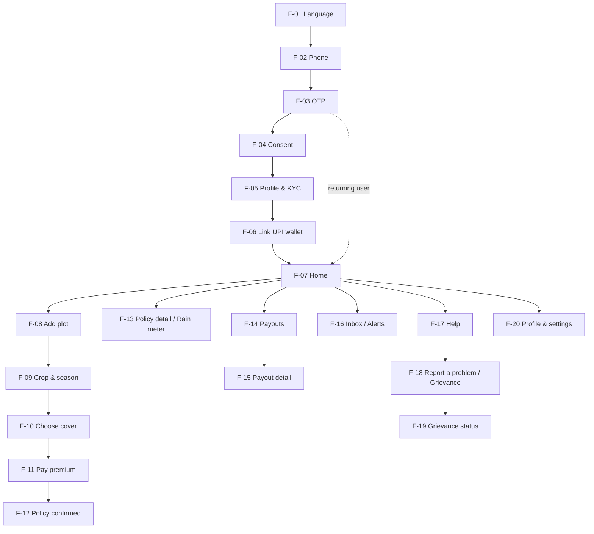
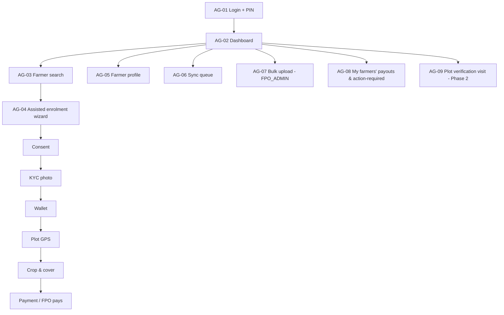
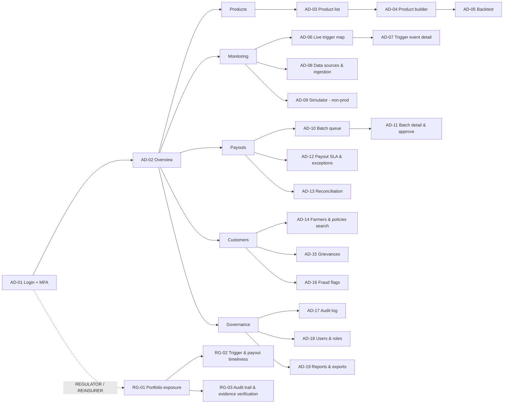

# 4. Frontend Spec Document — FasalShield

| Field | Value |
|-------|-------|
| Version | 0.1 (pre-build draft) |
| Apps | Farmer PWA (`apps/farmer`), Agent PWA (`apps/agent`), Admin & Oversight Web (`apps/admin`) |
| Implements | FR-01…FR-46 (UI parts), NFR-04…NFR-07, NFR-14 |

---

## 1. Platform decisions

| App | Form factor | Stack | Rationale |
|---|---|---|---|
| Farmer | Android-first **PWA** (installable), 360×640 baseline | React 18 + Vite, React Router, TanStack Query (persisted to IndexedDB), Workbox, i18next (ICU), Leaflet (lazy, only on plot screens) | No store install. Fits a 150 KB JS budget. Instant updates. Phase 2: Trusted Web Activity / Capacitor wrapper for Play Store, Play Integrity and mock-location detection (see Security FRD-03). |
| Agent | PWA, offline-first | Same + Dexie (IndexedDB) outbox, Background Sync API with a foreground-sync fallback | Works days without connectivity (NFR-04) |
| Admin & Oversight | Desktop web (≥ 1280 px), usable on tablet | React 18 + Vite, TanStack Query/Table, shadcn/ui (Radix + Tailwind), MapLibre GL, Recharts | Data-dense tables, maps, charts. `REGULATOR`/`REINSURER` get a read-only route set in the same app. |

Shared: `packages/ui` (tokens + primitives), `packages/i18n` (catalogues `en`, `hi`, `mr`, `te`), `packages/types` (DTOs generated from OpenAPI).

## 2. Information architecture and sitemaps

### 2.1 Farmer PWA

Bottom navigation (4 icon + label tabs): **Home** · **Payouts** · **Alerts** · **Help**. Profile is reached from the avatar in the header.

### 2.2 Agent PWA

### 2.3 Admin and oversight web

Navigation is role-aware. Menu items are hidden **and** the routes are guarded (server-side RBAC is authoritative).

## 3. Design principles for low-literacy users (farmer and agent apps)

1. **Icon + word + voice.** Every primary action has an icon, a short label (≤ 3 words) and a 🔊 button that plays a pre-recorded local-language audio clip (≤ 5 s, ~8 KB Opus each, lazy-cached).
2. **One task per screen.** Wizard steps with a visible progress indicator (dots plus "2 of 5"). No forms with more than 3 inputs.
3. **Large targets.** Minimum 48×48 dp; primary buttons are 56 dp tall and full width. Spacing ≥ 8 dp between targets.
4. **Numbers over text.** Show ₹ amounts, dates and gauges. Use the Indian digit grouping (₹1,23,456). Native digits are optional per language (setting).
5. **Visual status language.** Consistent colour + icon + label for each state (never colour alone): ✅ Active, ⏳ Waiting, ⚠️ Risk, 💰 Paid, ❌ Action needed.
6. **Forgiving input.** Numeric keypad for phone and OTP; OTP autofill (Web OTP API); no free-text where a choice will do; undo instead of confirm dialogs where possible.
7. **Trust cues.** Insurer logo and name, IRDAI product UIN on the policy card, the farmer's own photo or name on the home screen, "Money goes only to *your* UPI: ****@okaxis".
8. **Explain the index visually.** A "rain meter" bar compares normal rainfall with rainfall so far, with the payout thresholds marked, and a one-line sentence plus voice.
9. **Respect data costs.** No autoplay media, no web fonts beyond the needed script subset, images ≤ 30 KB, and a "data saver" mode on by default.
10. **Offline is normal.** Always show cached content with a "Last updated 2 h ago" chip. Never block on network for reading.

## 4. Screen-by-screen specs

States legend: **Empty** · **Loading** · **Error** · **Offline**. Skeletons are used for loading (no spinners over 300 ms on content screens).

### 4.1 Farmer PWA

| ID | Screen | Purpose | Components | Data shown | Actions | States | FR |
|---|---|---|---|---|---|---|---|
| F-01 | Language | Choose UI language at first run | Language tiles (script name in its own script + 🔊), FasalShield logo | Supported languages | Select → F-02 | Offline: works (bundled `en` + selected lang precached) | FR-02 |
| F-02 | Phone | Enter mobile number | Numeric phone input (+91 fixed), 🔊, primary button | — | Send OTP | Error: invalid number, rate-limited ("Try again in 10 min"); Offline: "Connect to internet to log in" with retry | FR-01 |
| F-03 | OTP | Verify | 6-box OTP input with Web OTP autofill, countdown, resend link, change number | Masked phone | Verify; Resend (after 30 s) | Error: wrong OTP (attempts left), expired; Loading: button spinner | FR-01 |
| F-04 | Consent | Informed consent (DPDP) | Illustrated summary cards (what we collect, why, who sees it), 🔊 full notice audio, "Read full notice" link, required + optional toggles | Notice version, insurer name, grievance officer contact | Agree & continue; Not now (exits) | Loading notice; Error: retry | FR-03 |
| F-05 | Profile & KYC | Basic identity | Name input (with voice-typing hint), village picker (search + recent), year of birth stepper, ID photo capture (camera), "Use DigiLocker" (Phase 2) | — | Save; Skip ID (allowed → KYC=NONE, limits cover) | Error: photo too dark / blurry (client check); Offline: saved locally and synced (draft) | FR-04 |
| F-06 | Link UPI wallet | Where money will go | VPA input with suggestions (`@ybl`, `@oksbi`...), "Open my UPI app" helper, verify button, result card (registered name) | Verified name for the VPA | Verify; Confirm "This is my account" | Error: invalid VPA, name mismatch (warn, needs confirmation → flagged); Loading | FR-05 |
| F-07 | Home | Status at a glance | Greeting with name, **policy cards** (crop icon, season, status chip, rain meter mini, SI), "Add plot / Buy cover" CTA, alerts banner, last-updated chip | Policies, latest index per policy, unread alerts count, payouts total | Open policy; Buy cover; Open alert | **Empty**: illustration + "Protect your crop from drought & flood" + Buy cover CTA; **Offline**: cached cards + chip; Error: cached + toast | FR-43 |
| F-08 | Add plot | Geo-tag the field | Instruction illustration "Stand in your field", **Get my location** button, accuracy meter (good < 20 m / ok < 50 m / poor), map preview (Leaflet, satellite tiles optional), "Adjust pin" drag, optional "Walk the boundary" (P1) | Lat/lng, accuracy, approx area | Capture (takes several fixes over ~10 s), Retake, Save | Error: permission denied (guide with screenshots to enable), poor accuracy (retry outdoors); Offline: capture works, saved as draft | FR-06 |
| F-09 | Crop & season | What is grown | Crop icon grid (local names), season segmented control (pre-selected), area input (acres/guntha with converter) | Eligible crops for district | Select → F-10 | Empty: "No covers yet in your area" + notify-me toggle | FR-07 |
| F-10 | Choose cover | Compare and understand covers | Cover cards: peril icon (☀️ drought / 🌊 flood), premium (big), cover amount, **"When do I get paid?"** mini rain meter with thresholds and example payouts, 🔊 explainer, key-facts link | Quote results | Select cover → F-11 | Loading skeleton; Empty: not eligible (reason: cut-off passed, district not covered); Error | FR-13 |
| F-11 | Pay premium | Pay via UPI | Amount summary (premium, subsidy, you pay), payer info, **Pay with UPI app** (intent), "FPO will pay" (if eligible), status poller | Net premium | Pay; Check status | Pending (polling, "Complete payment in your UPI app"); Failed (retry); Offline: blocked with explanation | FR-14 |
| F-12 | Policy confirmed | Celebrate and confirm | Success illustration, policy number, cover start date (after waiting period), "SMS sent" note, download certificate | Policy summary | Go home; Download PDF; Share on WhatsApp | — | FR-15 |
| F-13 | Policy detail | Understand status | Header (crop, plot thumbnail, policy no., UIN), **Rain meter** per phase (observed vs normal, threshold markers, deficit %), phase timeline, payouts for this policy, data source + "data as of" date, "Why no payment?" link | `/policies/{id}/index` | Download certificate; Report a problem | Offline: cached with as-of chip; Error: retry; data delayed banner if freshness > 72 h | FR-43, FR-25 |
| F-14 | Payouts | All money received | Total received (big), list of payout rows (date, ₹, status chip, reason short) | Payouts | Open detail | Empty: "No payouts yet. We'll pay automatically if rain crosses the limit."; Offline: cached | FR-43 |
| F-15 | Payout detail | Proof and reason | Amount, status timeline (Detected → Approved → Sent → Credited with timestamps), UPI ref (UTR), reason sentence ("Rain 53% below normal, 16 Jul–20 Aug"), masked VPA | Payout + trigger summary | Copy UTR; "Not received?" → F-18 prefilled | ACTION_REQUIRED state: red card "Update your UPI ID" → F-06 | FR-30, FR-43 |
| F-16 | Inbox / Alerts | Messages and risk alerts | List with icons per type, unread dot, 🔊 per message | Notifications | Open → deep link | Empty: "No messages" | FR-33, FR-25 |
| F-17 | Help | Support hub | Big tiles: "How it works" (video ≤ 60 s, opt-in download), "Call us" (tel:), "Report a problem", FAQ (voice) | Helpline, FPO contact | — | Offline: call link still works | FR-44 |
| F-18 | Report a problem | Raise grievance | Category tiles (crop lost but no payment / payment not received / wrong field / other), **hold-to-record voice note** (≤ 60 s), photo capture (≤ 3), optional text | Linked policy | Submit | Offline: queued with "Will send when online"; Error: retry | FR-44 |
| F-19 | Grievance status | Track ticket | Ticket no., status stepper, SLA date, resolution message (text + 🔊) | Grievance | Escalate (if unhappy, shows next escalation path) | — | FR-45 |
| F-20 | Profile & settings | Manage data | Name, phone, language switch, wallets (primary), consents (toggle with OTP), "Download my data", "Delete my account", logout | Profile | Edit, switch wallet (OTP), withdraw consent | Wallet change shows the 72 h cooling-off notice | FR-03, FR-05 |

### 4.2 Agent PWA

| ID | Screen | Purpose | Components | Data shown | Actions | States | FR |
|---|---|---|---|---|---|---|---|
| AG-01 | Login + PIN | Secure access | Phone/OTP (online), PIN pad (offline unlock), device status | — | Login; Unlock | Device not approved → "Ask your FPO admin"; 10 wrong PINs → wipe warning | FR-01 |
| AG-02 | Dashboard | Daily work | Sync status banner (pending N, last sync), tiles: Enrol farmer, Search, Action required (count), Today's enrolments, My farmers' payouts | Agent stats | Navigate; Sync now | Offline: banner "Offline — 12 records waiting"; Empty for a new agent: quick-start tips | FR-46 |
| AG-03 | Farmer search | Find or create | Search by phone/name/village (local first, then server), results with status chips, "New farmer" | Matches | Open profile; New farmer | Offline: searches local cache only (labelled); duplicate warning if the phone already exists | FR-08 |
| AG-04 | Assisted enrolment wizard | Enrol in ≤ 10 min | Steps: a) consent (play audio to farmer, capture farmer OTP **or** thumb-mark photo + agent declaration), b) identity + ID photo, c) UPI VPA (verify when online), d) plot GPS (multi-fix, accuracy, photo), e) crop + cover quote (cached products), f) payment: send UPI link by SMS / FPO pays / farmer pays now | Draft record | Next/Back; Save draft; Submit to queue | Offline: every step works; quote uses cached ProductVersion with "price confirmed on sync"; validation inline | FR-03…FR-08, FR-13 |
| AG-05 | Farmer profile | Overview of one farmer | Identity summary (masked), plots on mini-map, policies, payouts, grievances, flags (visible only as "Needs review") | Farmer | Add plot; Buy cover; Raise grievance on behalf | — | FR-08 |
| AG-06 | Sync queue | Transparency on offline data | List of outbox ops with status (Pending, Sending, Done, **Rejected** + reason + fix action), retry all | Outbox | Retry; Fix & resubmit; Discard (with confirm) | Conflict: "Farmer already exists — merge?" | NFR-04 |
| AG-07 | Bulk upload (FPO_ADMIN) | CSV enrolment | Template download, file picker, validation progress, error table (row, field, message), download error report | Import job | Upload; Fix & re-upload; Confirm create drafts | Large file (> 5k rows) blocked with message | FR-09 |
| AG-08 | Payouts & action required | Help farmers get paid | List filtered: Action required (invalid VPA), Sent today, Pending | Payouts of assigned farmers | Call farmer; Update wallet (needs farmer OTP) | Empty: "All payouts are fine" | FR-30 |
| AG-09 | Plot verification visit (Phase 2) | Verify flagged plots | Task list, navigate to plot, capture GPS + photo, checklist | Flagged plots | Verify / Reject with reason | Offline capable | FR-38 |

### 4.3 Admin and oversight web

| ID | Screen | Purpose | Components | Data shown | Actions | States | FR |
|---|---|---|---|---|---|---|---|
| AD-01 | Login + MFA | Staff auth | Email/password or SSO button, WebAuthn/TOTP prompt | — | Sign in | Locked account; MFA enrolment flow for first login | FR-42 |
| AD-02 | Overview | Daily health | KPI cards (active policies, SI exposure, premium, paid this season, loss ratio, payout p95 latency, SLA at risk), pipeline health strip (per source freshness), queues (batches awaiting approval, held events, open grievances, flags) | `/reports/portfolio`, `/sla/payouts`, `/data-sources` | Click-through to queues | Loading skeletons; Error per card (card-level retry) | FR-36 |
| AD-03 | Product list | Manage products | Table: code, name, peril, versions, status, season, policies count | Products | New product; Open | Empty: "Create your first product" | FR-11 |
| AD-04 | Product builder | Design rules | Form sections: basics → index (type, metric, sources, baseline) → phases (date range editor with timeline) → slabs (table editor + live payout curve chart) → pricing (premium rate, SI, subsidy) → eligibility (district multi-select on map, crops) → enrolment (cut-off, waiting period); JSON preview (read-only); validation panel; version diff vs previous | Draft version | Save draft; Run backtest; Submit; Publish (step-up, not author) | Validation errors inline; published versions read-only with "Create new version" | FR-11, FR-12 |
| AD-05 | Backtest | Price and understand risk | Year × district heatmap of payout %, burn cost chart, trigger frequency, worst years table | Backtest result | Export; Compare versions | Running (progress); Failed (reason) | FR-16 |
| AD-06 | Live trigger map | Situational awareness | MapLibre map with grid-cell choropleth (deficit % or flood fraction), toggles: product, peril, date slider, layer for policies (clustered dots), triggered cells outline; side panel with cell details (time series sparkline, policies, events) | `/map/cells`, events | Select cell; open event list; jump to batch | No data for date (hatched cells + legend "no data/quarantined"); Loading tiles | FR-35 |
| AD-07 | Trigger event detail | Evidence | Summary (policy, farmer masked, cell, phase, slab, amount), evidence viewer (readings table + chart vs baseline + threshold), rule version link (hash), **Verify evidence** button (hash + re-evaluation result), status history, fraud flags | `/trigger-events/{id}` | Release / Reject (if HELD, with reason) | Verification failed → red banner + alert | FR-23, FR-26 |
| AD-08 | Data sources & ingestion | Pipeline ops | Source cards (expected vs actual latency, last success), runs table with QC report, quarantine queue | Runs | Re-run ingestion; Release quarantine (`SYS_ADMIN`, with note) | Stale source warning | FR-17, FR-20 |
| AD-09 | Simulator (non-prod) | Demo and testing | Region picker (district multi-select / draw polygon), metric, date range, mode (% of normal / absolute), preview chart, "Run evaluation now" | Scenarios | Create scenario; Trigger evaluation | Hidden in prod; env badge "DEMO" always visible | FR-21 |
| AD-10 | Batch queue | Approve payouts | Tabs: Draft · Submitted · Approved · Processing · Completed · Rejected; table: batch no., product, region, count, total ₹, oldest SLA due, flags, submitter | Batches | Open; Submit (maker) | Empty per tab; SLA due < 4 h shown in red | FR-27, FR-37 |
| AD-11 | Batch detail & approve | Maker-checker | Summary header (total, count, SLA countdown, batch hash), distribution charts (by district, amount), payouts table (farmer masked, VPA masked, amount, slab, evidence link, flags), checklist (evidence verified ✓, funding available ✓) | Batch | Submit (maker); Approve / Reject (checker, step-up modal); remove a payout → back to held (maker only, before submit) | Approver = submitter → button disabled with tooltip "Separation of duties"; funding insufficient → blocked | FR-28 |
| AD-12 | Payout SLA & exceptions | Make sure money lands | SLA histogram, at-risk list (> 12 h), ACTION_REQUIRED list, failure reasons breakdown | `/sla/payouts`, payouts | Retry; Contact agent; Escalate | — | FR-30, FR-32 |
| AD-13 | Reconciliation | Match money | Run list, mismatch table (type, our record, gateway record), resolution notes | Recon | Resolve mismatch | — | FR-31 |
| AD-14 | Farmers & policies | Customer lookup | Search (phone/policy no./farmer code), farmer 360 (masked; unmask with step-up and reason), plots map, policies, payouts, notifications log | Farmer | Unmask PII (audited); Cancel policy; Remap plot | — | FR-42 |
| AD-15 | Grievances | Basis-risk handling | Queue with SLA, detail: farmer's voice/photos, auto-attached index evidence, neighbouring cells comparison chart, outcome form (templates per language) | Grievances | Assign; Resolve (outcome); Escalate to ex-gratia | — | FR-45 |
| AD-16 | Fraud flags | Investigate | Table (rule FRD-xx, score, entity, age), detail with signals (map of overlapping plots, shared VPAs graph) | Flags | Clear / Confirm / Escalate (note required) | — | FR-38 |
| AD-17 | Audit log | Governance | Filterable log table, entry detail with diff (redacted), chain verification status widget | Audit | Verify range; Export (step-up) | Verification failed → critical banner | FR-39 |
| AD-18 | Users & roles | Access management | Users table, invite, role assignment (SoD warnings), MFA status, last login | Users | Invite; Change role (step-up); Disable | Cannot edit self-role | FR-42 |
| AD-19 | Reports & exports | Standard reports | Report catalogue, filters, async export list | Exports | Generate; Download (audited) | — | FR-40 |
| RG-01 | Portfolio exposure (REGULATOR/REINSURER) | Oversight | District choropleth of SI exposure, table by product/peril, accumulation hotspots | Aggregates | Export (audited) | Read-only badge | FR-41 |
| RG-02 | Timeliness | Oversight | Payout latency distribution, SLA breaches, grievance stats | Aggregates | Drill to event (REGULATOR only) | — | FR-41 |
| RG-03 | Audit & evidence | Oversight | Audit log (read-only), trigger evidence verification | Audit | Verify | — | FR-39, FR-41 |

## 5. Design tokens

### 5.1 Colour (light theme; dark theme for admin only in Phase 2)

| Token | Value | Use | Contrast note |
|---|---|---|---|
| `color.brand.primary` | `#1B6E3A` (field green) | Primary buttons, active nav | White text 6.3:1 ✓ |
| `color.brand.primaryHover` | `#155A2F` | Hover/pressed | — |
| `color.brand.secondary` | `#8A5A2B` (soil brown) | Secondary accents, crop icons | White text 5.9:1 ✓ |
| `color.peril.drought` | `#B45309` (ochre) | Drought chips, deficit bars | White text 5.0:1 ✓ |
| `color.peril.flood` | `#1D4ED8` (river blue) | Flood chips, SAR layers | White text 6.7:1 ✓ |
| `color.status.success` | `#15803D` | Paid, Active | Pair with ✅ icon |
| `color.status.warning` | `#A16207` | Risk alert, waiting | Use on `#FEF9C3` bg with dark text |
| `color.status.danger` | `#B91C1C` | Action required, failures | White text 6.5:1 ✓ |
| `color.status.info` | `#0369A1` | Info banners | — |
| `color.text.primary` | `#1F2937` | Body text | On white 14.7:1 ✓ |
| `color.text.secondary` | `#4B5563` | Secondary text | On white 7.6:1 ✓ |
| `color.surface.base` | `#FFFFFF` | Background | — |
| `color.surface.muted` | `#F5F3EE` (warm paper) | Cards on farmer app, reduces glare | — |
| `color.border` | `#D6D3CE` | Dividers | Non-text 3:1 not required for decorative lines |
| `color.focus` | `#F59E0B` 3 px outline | Focus ring | ≥ 3:1 against adjacent ✓ |
| Map sequential (deficit) | `#FFF7E6 → #FDD9A0 → #F3A44C → #C2410C → #7C2D12` | Choropleth | Plus hatch pattern for "no data" |
| Map sequential (flood) | `#EFF6FF → #93C5FD → #3B82F6 → #1D4ED8 → #1E3A8A` | Choropleth | — |

All pairs are checked with an automated contrast test in CI (axe + custom token checker). Colour is never the only carrier of meaning.

### 5.2 Typography

| Token | Farmer / Agent | Admin |
|---|---|---|
| Font family | System UI stack + **Noto Sans** subsets per script (`Noto Sans Devanagari`, `Noto Sans Telugu`), loaded only for the active language, `font-display: swap` | Inter (Latin) + Noto fallbacks |
| `font.size.body` | 18 px / line-height 1.5 | 14 px / 1.45 |
| `font.size.small` | 16 px (minimum anywhere) | 12 px |
| `font.size.h1` | 28 px | 24 px |
| `font.size.h2` | 22 px | 18 px |
| `font.size.amount` | 36 px tabular numerals | 20 px |
| Weights | 400 / 600 / 700 | 400 / 500 / 600 |

Indic scripts need +10–15% line height. Avoid all-caps (it has no meaning in Indic scripts and hurts Latin readability).

### 5.3 Spacing, radius, elevation, motion

| Token | Value |
|---|---|
| `space.*` | 4-pt scale: 4, 8, 12, 16, 24, 32, 48 |
| `size.touch.min` | 48 px; `size.touch.primary` 56 px |
| `radius.sm/md/lg` | 6 / 10 / 16 px |
| `elevation.card` | `0 1px 2px rgba(0,0,0,.08)` (avoid heavy shadows; cheap to paint) |
| `motion.duration` | 150 ms (micro), 250 ms (page); `prefers-reduced-motion` disables non-essential motion |
| Breakpoints | 360 (base), 600, 900, 1280 (admin base), 1600 |

### 5.4 Component library (`packages/ui`)

**Shared primitives:** Button (primary/secondary/ghost/danger, loading), IconButton, AudioButton (🔊 with play state), TextField, NumericKeypadField, OTPInput, Select / ChoiceTiles (icon grid), SegmentedControl, Stepper (wizard progress), Card, StatusChip (status → colour + icon + label mapping), Banner (info/warn/error/offline), Toast, Modal/Sheet (bottom sheet on mobile), Skeleton, EmptyState (illustration + message + CTA), Avatar, Amount (₹ with Indian grouping, tabular), DateText (locale-aware), LanguageSwitcher.

**Farmer/Agent domain:** PolicyCard, RainMeter (observed vs normal bar, threshold markers, deficit %), PhaseTimeline, PayoutTimeline, LocationCapture (multi-fix GPS + accuracy meter), MapPicker (Leaflet, lazy), PhotoCapture (with blur/brightness check), VoiceRecorder (hold-to-record, ≤ 60 s), SyncStatusBar, OutboxItem, ConsentCard.

**Admin domain:** DataTable (TanStack: sort, filter, column picker, virtualised), KPIStat, ChartCard (Recharts line/bar/heatmap), ChoroplethMap (MapLibre), CellInspector, RuleSlabEditor + PayoutCurve, DateRangeTimeline, EvidenceViewer, HashBadge (verified ✓ / failed ✗), StepUpDialog, SoDGuard (disabled action with reason), AuditDiff, MaskedField (with unmask flow).

## 6. Accessibility (WCAG 2.1 AA)

- Semantic HTML first; Radix primitives for dialogs and menus (focus trap, ARIA). Every icon-only button has an accessible name in the current language.
- Contrast: text ≥ 4.5:1 (≥ 3:1 for ≥ 24 px), UI components ≥ 3:1 (token table §5.1).
- Fully keyboard-operable admin, with visible focus ring (`color.focus`) and skip links.
- Screen readers: TalkBack is tested on the farmer and agent apps. `lang` is set per locale so TalkBack uses the right voice. Amounts are read as words via `aria-label` ("3750 rupees").
- Text resize to 200% without loss; reflow at 320 px wide.
- Do not depend on precise gestures: map pin drag has a "Move pin" button alternative; hold-to-record has a tap-to-start/tap-to-stop alternative.
- Time limits: OTP countdown is extendable (resend); no session timeout while filling the enrolment wizard (drafts autosave).
- Errors are identified in text + icon and announced (`aria-live="polite"`).
- Media: audio prompts have text equivalents on screen; "How it works" video has captions in each language.
- Automated checks: axe-core in Playwright/Storybook CI; a manual audit before pilot.

## 7. Performance budget (low-end devices, 2G/3G)

Reference device: Android Go, 1 GB RAM, quad-core 1.3 GHz, Chrome; network "Slow 3G" (400 kbps, 400 ms RTT).

| Metric | Farmer PWA | Agent PWA | Admin |
|---|---|---|---|
| Initial JS (gzip) | **≤ 150 KB** | ≤ 220 KB | ≤ 400 KB (route-split) |
| Initial CSS | ≤ 20 KB | ≤ 25 KB | ≤ 60 KB |
| Fonts | ≤ 60 KB (one script subset) | ≤ 60 KB | ≤ 100 KB |
| Total first load (cold) | ≤ 400 KB | ≤ 600 KB | — |
| Repeat load (SW cache) | < 1.5 s to cached Home | < 1.5 s | — |
| LCP (slow 3G, cold) | ≤ 4 s | ≤ 5 s | ≤ 2.5 s (broadband) |
| TTI / INP | TTI ≤ 5 s; INP ≤ 200 ms | same | INP ≤ 200 ms |
| API payload per screen | ≤ 30 KB JSON | ≤ 50 KB | paged |
| Map | Leaflet (~42 KB gz) loaded **only** on F-08/AG-04d; tiles cached ≤ 5 MB | same | MapLibre (route-split) |
| Images | WebP/AVIF, ≤ 30 KB, illustrations as inline SVG sprites | same | — |
| Audio prompts | Opus ~8 KB each, cached on first play | precached for the wizard | — |

Techniques: route-level code-splitting; Preact/compat considered if the budget is breached; no moment/lodash-full; `date-fns` per-function imports; Brotli on the CDN; HTTP caching with immutable hashed assets; a stale-while-revalidate data cache; **Lighthouse CI budgets fail the build** on regression.

Offline (Workbox):
- Precache: app shell, current language catalogue, icons, audio for core screens.
- Runtime: `GET /me`, `/policies*`, `/payouts*` → StaleWhileRevalidate persisted in IndexedDB (TanStack persist).
- Agent outbox: Dexie table `outbox(clientId, type, payload, createdAt, status, error)` → `POST /sync` in order, idempotent by `clientId`; retries with backoff; Background Sync where supported, plus "Sync now".

## 8. Localisation

- i18next + ICU MessageFormat; keys are namespaced (`farmer.home.title`); no string concatenation.
- MVP languages: `en`, `hi`, `mr`, `te`. Translator workflow via a TMS (e.g. Tolgee / Crowdin), with farmer-validated wording (pilot usability test).
- Numbers and currency via `Intl.NumberFormat('en-IN' / 'hi-IN' …)`; dates via `Intl.DateTimeFormat`; area units with a local converter (acre, guntha, bigha by state config).
- Audio prompts recorded by native speakers; the file key matches the string key (`farmer.home.title.mp3/opus`).
- Notifications (SMS/WhatsApp) use templates in `packages/i18n/notifications/{lang}` and must also be registered on DLT / WhatsApp.

## 9. Key user flows (step by step)

### UF-1 Farmer onboarding (F-01 → F-07)
1. Opens the link from SMS → F-01 shows 4 language tiles; taps **मराठी** (audio plays the welcome).
2. F-02: enters a 10-digit number → **Send OTP**. Client validation; the server rate-limits.
3. F-03: OTP autofills (Web OTP) → **Verify** → JWT + device key registered. The new user goes to F-04.
4. F-04: sees 3 illustrated cards, taps 🔊 to hear the full notice, ticks the required consent → **Agree**. `POST /farmers/{id}/consents`.
5. F-05: enters name (voice typing allowed), selects village (search), takes an ID photo (client blur check) → **Save**.
6. F-06: enters VPA → **Verify** → sees "Registered name: SAVITA R. PATIL" → **Yes, this is mine**. Wallet `VERIFIED`.
7. Lands on F-07 Home (empty state) with **Buy cover** CTA.

### UF-2 Buy policy (F-07 → F-12)
1. F-07 **Buy cover** → F-08: "Stand in your field" → **Get my location** → 5 fixes over 10 s → accuracy 12 m (green) → map preview → **Save plot**. `POST /farmers/{id}/plots` returns `gridCellId`.
2. F-09: taps the **Soybean** tile; season **Kharif 2026** pre-selected; area 1.5 acres.
3. F-10: `POST /quotes` → two cards: ☀️ *Drought Cover* ₹450 (cover ₹15,000) and 🌊 *Flood Cover* ₹300. Taps "When do I get paid?" → rain meter explainer + audio. Selects Drought.
4. F-11: summary shows premium ₹750, subsidy ₹300, **you pay ₹450** → **Pay with UPI** → UPI app opens (intent) → farmer approves → returns to the app → status polling → success.
5. F-12: policy `FS-P-26K-000123`, cover starts in 7 days; SMS + WhatsApp sent; **Download certificate**.

### UF-3 Receive payout (system → F-15)
1. 22 Aug 03:00 IST: ingestion completes; the trigger engine finds Latur cell 412233 at a 52.8% deficit for phase P2 → slab 1 (25% of phase weight 40% × SI ₹15,000 = ₹1,500) → `TriggerEvent` + evidence.
2. Fraud precheck clean → payout `AWAITING_BATCH` → hourly batch `PB-20260822-04` created (₹3.2 lakh, 214 payouts) → within auto-approval limits → auto-approved (logged), or else ops approves (UF-4).
3. The payout-worker sends to the gateway → webhook `processed` with UTR at 04:12 → payout `SUCCESS`.
4. The farmer gets an SMS/WhatsApp in Marathi: "₹1,500 sent to ****@ybl. Reason: rain 53% below normal (16 Jul–20 Aug). Policy FS-P-26K-000123."
5. Opens the app → F-07 shows a 💰 chip on the policy → F-15 shows the timeline Detected 03:14 → Approved 04:00 → Sent 04:05 → Credited 04:12, with UTR.

### UF-4 Admin approves a payout batch (AD-10 → AD-11)
1. `CLAIMS_OPS` opens AD-10 → **Draft** tab → batch `PB-20260822-05` (₹18.4 lakh, 1,203 payouts, above the auto limit).
2. AD-11: reviews distribution by district, samples 3 evidence links (AD-07 opens in a drawer; **Verify evidence** ✓), removes 2 payouts with name-mismatch flags (back to held) → batch hash recalculated → **Submit** with a note.
3. `PAYOUT_APPROVER` (a different user) gets a notification → opens AD-11 → checklist all ✓ (funding available, evidence verified, no open flags) → **Approve** → StepUpDialog (passkey) → approved.
4. Disbursement starts within 5 min; the SLA countdown and a progress bar (sent/success/failed) update live. Failures with `INVALID_VPA` appear in AD-12 for agent follow-up.
