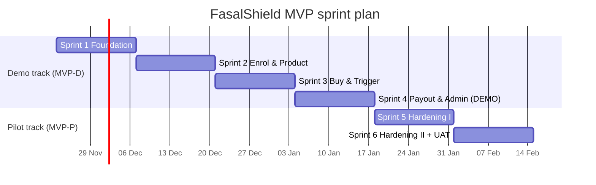

# 5. Feature Ticket List — FasalShield

| Field | Value |
|-------|-------|
| Version | 0.1 (pre-build draft) |
| Estimation | Fibonacci story points (1, 2, 3, 5, 8, 13). Velocity assumption: ~45 pts per 2-week sprint (PRD A-10) |
| Release tags | **MVP-D** = demo-ready (Sprints 1–4) · **MVP-P** = pilot-ready (Sprints 5–6) · **P2** = Phase 2 · **P3** = Phase 3 |
| Priority | **P0** must have · **P1** should have · **P2** could have |

---

## 1. Epics

| Epic | Name | Scope | FRs | MVP pts |
|---|---|---|---|---|
| EP-01 | Platform foundation and DevOps | Monorepo, schema, CI, environments, mocks, app shells, observability, demo seed | NFR-03, NFR-12, NFR-13, NFR-15 | 37 |
| EP-02 | Auth and identity | OTP, staff MFA, step-up, RBAC | FR-01, FR-42 | 18 |
| EP-03 | Farmer onboarding | Language, consent, KYC, wallet | FR-02…FR-05 | 16 |
| EP-04 | Plot and crop | GPS plot, cell mapping, catalogue | FR-06, FR-07, FR-19 | 10 |
| EP-05 | Product engine | Rule schema, builder, versioning, backtest | FR-11, FR-12, FR-16 | 19 |
| EP-06 | Policy and premium | Quote, payment, issuance, farmer policy views | FR-13…FR-15, FR-43 | 21 |
| EP-07 | Data ingestion and simulator | Simulator, baseline, geo-worker, connectors, DQ | FR-17…FR-21 | 16 |
| EP-08 | Trigger engine | Evaluation, evidence, routing, alerts | FR-22…FR-26 | 19 |
| EP-09 | Payout engine | Batching, maker-checker, disbursement, retries, SLA, recon | FR-27…FR-32 | 24 |
| EP-10 | Notifications | Templates, SMS, in-app, WhatsApp, push | FR-33, FR-34 | 3 |
| EP-11 | Agent and FPO tools | Assisted enrolment, offline, bulk, dashboard | FR-08, FR-09, FR-46 | 8 |
| EP-12 | Admin dashboard and reporting | Shell, map, evidence, batch UI, users, dashboards | FR-35…FR-37, FR-42, FR-36 | 24 |
| EP-13 | Grievance and basis risk | Submission, triage | FR-44, FR-45 | 0 |
| EP-14 | Security, audit and fraud | Audit chain, encryption, fraud rules, security tests | FR-38, FR-39, NFR-09…NFR-11 | 18 |
| EP-15 | Oversight portal | Regulator and reinsurer views | FR-40, FR-41 | 0 |
| | **Total MVP** | | | **233** (Demo 179 + Pilot 54) |

## 2. MVP stories (full detail)

---

### EP-01 Platform foundation and DevOps

#### FS-0101 — Monorepo scaffold and local stack · `MVP-D` · P0 · 5 pts
- **Story:** As a developer, I want a monorepo with all apps and a one-command local stack, so that the whole team can build and demo offline.
- **Description:** pnpm + Turborepo with the layout in Architecture §12. `docker compose` runs Postgres 16 + PostGIS, Redis, MinIO (S3), mock gateway and SMS sink.
- **Acceptance criteria:**
  - *Given* a fresh clone, *when* I run `pnpm i && pnpm dev:up`, *then* the API, 3 frontends, workers and infra start, and `/health` returns 200.
  - *Given* the stack is running, *when* I open the farmer app, *then* it loads at `localhost` with no external network calls required.
- **Deps:** — · **Refs:** NFR-13
- **Tasks:** T1 workspace + Turborepo pipelines · T2 docker compose (PG/PostGIS, Redis, MinIO) · T3 shared tsconfig/eslint/prettier · T4 README dev guide

#### FS-0102 — CI pipeline · `MVP-D` · P0 · 3 pts
- **Story:** As a tech lead, I want CI to lint, type-check, test and build every PR, so that main is always demo-able.
- **AC:** *Given* a PR, *when* CI runs, *then* lint, typecheck, unit tests, the rules golden tests and the OpenAPI diff all pass, or the PR is blocked. *Given* a merge to main, *when* CI finishes, *then* Docker images are pushed with the git SHA tag.
- **Deps:** FS-0101 · **Refs:** NFR-12
- **Tasks:** T1 GitHub Actions workflow · T2 build cache · T3 gitleaks + `npm audit`/`pip-audit` · T4 image build/push

#### FS-0103 — Database schema baseline · `MVP-D` · P0 · 5 pts
- **Story:** As a backend developer, I want the core schema with PostGIS and constraints from day one, so that idempotency and geo rules are enforced by the DB.
- **Description:** All ERD entities (Architecture §5.1), with encrypted columns as `bytea`, `IndexReading` monthly partitions, unique constraints for trigger and payout idempotency, a CHECK on `paid_out_paise ≤ sum_insured_paise`, and DB roles (`app_rw`, `geo_writer`, `audit_append`).
- **AC:** *Given* migrations run, *when* I insert two `TriggerEvent` rows with the same `(policy_id, product_version_id, phase_id, slab_level)`, *then* the second fails. *Given* the `app_rw` role, *when* it attempts to UPDATE `audit_log`, *then* permission is denied.
- **Deps:** FS-0101 · **Refs:** NFR-11, NFR-16
- **Tasks:** T1 Drizzle schema + migrations · T2 PostGIS indexes (GIST) · T3 partitions + maintenance job · T4 DB roles and grants · T5 seed script skeleton

#### FS-0104 — Provider interfaces and mock adapters · `MVP-D` · P0 · 5 pts
- **Story:** As a developer, I want `PaymentProvider`, `MessagingProvider` and `KycProvider` interfaces with configurable mocks, so that the demo runs end-to-end without third parties.
- **AC:** *Given* `PAYMENT_PROVIDER=mock`, *when* a payout is created, *then* the mock returns accepted and later sends a signed webhook after a configurable delay. Failure modes (`INVALID_VPA`, timeout, 5xx) can be injected by VPA suffix (e.g. `fail-invalid@mock`). *Given* `MESSAGING_PROVIDER=console`, *when* a message is sent, *then* it appears in the dev SMS sink UI.
- **Deps:** FS-0101 · **Refs:** NFR-13, FR-29
- **Tasks:** T1 interfaces in `packages/types` · T2 mock payment server (collect + payout + webhook signing) · T3 console/sink messaging · T4 mock KYC · T5 provider registry by config

#### FS-0105 — Cloud environments (staging/demo) · `MVP-P` · P1 · 8 pts
- **Story:** As an ops engineer, I want Terraform-managed staging and prod in ap-south-1, so that the pilot runs on reproducible, India-resident infrastructure.
- **AC:** *Given* Terraform apply, *when* it finishes, *then* VPC, RDS (PostGIS, encrypted, PITR), ElastiCache, S3 (evidence bucket with Object Lock compliance mode), ECS services, ALB + WAF and Secrets Manager exist, and the app deploys from CI. *Given* the prod env, *when* `/simulator` is called, *then* it returns 404.
- **Deps:** FS-0102 · **Refs:** NFR-03, NFR-15, NFR-17
- **Tasks:** T1 network + RDS + Redis · T2 S3 buckets (raw, evidence WORM, uploads) · T3 ECS services + autoscaling · T4 CI deploy with manual prod gate · T5 backups + restore drill doc

#### FS-0106 — Observability baseline · `MVP-P` · P1 · 3 pts
- **Story:** As an on-call engineer, I want structured logs, traces, key metrics and alerts, so that I know when ingestion, evaluation or payouts are late.
- **AC:** *Given* a payout request, *when* I search its `traceId`, *then* I see spans across API → queue → worker → gateway. *Given* a payout older than 20h not credited, *when* the SLA job runs, *then* a P1 alert fires.
- **Deps:** FS-0101 · **Refs:** NFR-12
- **Tasks:** T1 OTel SDK in API/workers · T2 PII redaction in logger · T3 metrics from Architecture §11 · T4 alert rules + dashboard JSON

#### FS-0107 — App shells and shared UI package · `MVP-D` · P0 · 5 pts
- **Story:** As a frontend developer, I want PWA shells for the farmer and agent apps and a web shell for admin, built on shared tokens and components, so that screens are consistent and within budget.
- **AC:** *Given* the farmer app build, *when* Lighthouse CI runs at Slow 3G / Moto G4 throttling, *then* initial JS ≤ 150 KB gzip and the build fails if exceeded. *Given* the app is installed, *when* offline, *then* the shell loads from the service worker.
- **Deps:** FS-0101 · **Refs:** NFR-05, NFR-06, NFR-14
- **Tasks:** T1 tokens (Frontend §5) as CSS vars + Tailwind preset · T2 primitives (Button, Card, StatusChip, Banner, Skeleton, EmptyState, Amount) · T3 Workbox setup · T4 Lighthouse CI budgets · T5 Storybook + axe

#### FS-0108 — Demo seed and end-to-end demo script · `MVP-D` · P0 · 3 pts
- **Story:** As a presenter, I want one command that seeds a realistic pilot (2 districts, 200 farmers, 2 products) and a scripted drought scenario, so that the demo is repeatable in under 10 minutes.
- **AC:** *Given* `pnpm demo:reset`, *when* it completes, *then* seeded users exist for every role, with known credentials printed. *Given* the demo script, *when* I run "Latur 50% deficit", *then* trigger events, an auto-approved batch, a manual batch and payout SMS appear within 2 minutes.
- **Deps:** FS-0701, FS-0801, FS-0903 · **Refs:** FR-21
- **Tasks:** T1 seed generator · T2 scenario CLI · T3 demo runbook (docs/demo.md)

---

### EP-02 Auth and identity

#### FS-0201 — Farmer OTP login and tokens · `MVP-D` · P0 · 5 pts
- **Story:** As a farmer, I want to log in with my phone number and an SMS code, so that I don't need to remember a password.
- **AC:** *Given* a valid Indian mobile, *when* I request an OTP, *then* a 6-digit OTP valid for 5 min is sent and only its HMAC is stored. *Given* 3 wrong attempts, *when* I try again, *then* the OTP is invalidated. *Given* a 6th request in an hour, *when* I request, *then* I get 429 with retry-after. *Given* a valid OTP, *when* verified, *then* I receive a 15-min access JWT and a rotating refresh cookie, and reuse of an old refresh token revokes the family.
- **Deps:** FS-0103, FS-0104 · **Refs:** FR-01, Security §3.1, TH-01
- **Tasks:** T1 OTP request/verify endpoints · T2 rate limiter (Redis) · T3 JWT ES256 + refresh rotation · T4 F-02/F-03 screens with Web OTP · T5 tests

#### FS-0202 — Staff login with TOTP MFA · `MVP-D` · P0 · 5 pts
- **Story:** As an insurer staff member, I want secure login with MFA, so that payout and product functions are protected.
- **AC:** *Given* a new staff user, *when* they first log in, *then* TOTP enrolment is required before any access. *Given* valid password + TOTP, *when* they sign in, *then* a session (10-min access, 8h absolute, 30-min idle) starts. *Given* 5 failed attempts, *then* the account is locked for 15 min.
- **Deps:** FS-0103 · **Refs:** FR-42, Security §3.3
- **Tasks:** T1 Argon2id passwords · T2 TOTP enrolment + verify · T3 AD-01 screen · T4 lockout + audit events

#### FS-0203 — Step-up authentication · `MVP-D` · P0 · 3 pts
- **Story:** As a payout approver, I want to re-confirm my identity when approving, so that a hijacked session cannot release money.
- **AC:** *Given* an approve action, *when* no valid step-up token bound to that action and resource is present, *then* the API returns 401 `step_up_required`. *Given* a step-up token, *when* used twice or after 5 min, *then* it is rejected.
- **Deps:** FS-0202 · **Refs:** FR-28, Security §3.3
- **Tasks:** T1 `/auth/step-up` · T2 `@RequireStepUp()` guard · T3 StepUpDialog component

#### FS-0204 — RBAC guard and row-scope policy layer · `MVP-D` · P0 · 5 pts
- **Story:** As a security engineer, I want every endpoint to enforce the role × resource × action matrix with row scope, so that users only see what they are allowed to.
- **AC:** *Given* the RBAC matrix (Security §2) as code, *when* the generated authz test suite runs, *then* every role × endpoint combination behaves as specified. *Given* an `AGENT`, *when* requesting a farmer not assigned to them, *then* 404 is returned (no existence leak). *Given* the same user as submitter, *when* approving a batch, *then* 403 `sod_violation`.
- **Deps:** FS-0201, FS-0202 · **Refs:** FR-42, NFR-09, TH-09
- **Tasks:** T1 policy definitions (CASL) · T2 scope injection in repositories · T3 PG RLS on PII tables · T4 matrix-driven tests

---

### EP-03 Farmer onboarding

#### FS-0301 — Language selection and i18n framework · `MVP-D` · P0 · 3 pts
- **Story:** As a farmer, I want the app in my language, so that I understand what I am buying.
- **AC:** *Given* first launch, *when* I pick Marathi, *then* all UI, numbers (en-IN grouping) and dates render in Marathi and only the Devanagari font subset is downloaded. *Given* a missing key, *when* rendering, *then* English is shown and the key is reported to Sentry.
- **Deps:** FS-0107 · **Refs:** FR-02, NFR-07
- **Tasks:** T1 i18next + ICU setup · T2 catalogues en/hi/mr/te (MVP strings) · T3 F-01 screen · T4 font subsetting per script

#### FS-0302 — Consent capture and withdrawal · `MVP-D` · P0 · 3 pts
- **Story:** As a farmer, I want to know what data is collected and agree to it, so that I stay in control of my information.
- **AC:** *Given* F-04, *when* I agree, *then* a `Consent` record stores purpose, `notice_version`, language, channel and timestamp. *Given* no `INSURANCE_SERVICING` consent, *when* buying a policy, *then* the API returns 403 `consent_required`. *Given* I withdraw marketing consent with OTP, *then* `withdrawn_at` is set and audit-logged.
- **Deps:** FS-0201, FS-0301 · **Refs:** FR-03, NFR-10
- **Tasks:** T1 consent API · T2 F-04 screen + audio · T3 notice versioning config · T4 withdrawal in F-20

#### FS-0303 — Basic KYC with ID photo · `MVP-P` · P0 · 5 pts
- **Story:** As a farmer, I want to give my name and ID photo, so that the insurer can identify me for payouts.
- **AC:** *Given* F-05, *when* I upload an ID photo, *then* it goes by presigned URL (≤ 2 MB, image types only), is malware-scanned and stored encrypted, and `kyc_status=BASIC`. *Given* an ID number is entered, *then* only the last 4 digits and a peppered hash are stored. *Given* a blurry image (client Laplacian check), *then* the user is asked to retake.
- **Deps:** FS-0302, FS-1404 · **Refs:** FR-04, Security §4.2
- **Tasks:** T1 uploads API (presign) · T2 KYC endpoint + hash/dedup · T3 F-05 screen + PhotoCapture · T4 MockKycProvider path

#### FS-0304 — UPI wallet linking · `MVP-D` · P0 · 5 pts
- **Story:** As a farmer, I want to link my UPI ID and see my registered name, so that I'm confident payouts reach me.
- **AC:** *Given* a VPA, *when* I tap Verify, *then* the provider validation returns the registered name and the wallet is `VERIFIED`, shown masked. *Given* a name mismatch above the threshold, *then* the wallet is saved with a flag (FRD-06). *Given* a wallet change, *when* confirmed by OTP, *then* `cooling_off_until = now + 72h` and payouts during cooling-off use the previous wallet.
- **Deps:** FS-0104, FS-0201 · **Refs:** FR-05, Security §6, FRD-07
- **Tasks:** T1 wallet API + encryption · T2 validation via PaymentProvider · T3 F-06 screen · T4 cooling-off logic

---

### EP-04 Plot and crop

#### FS-0401 — Plot GPS pin capture and cell mapping · `MVP-D` · P0 · 5 pts
- **Story:** As a farmer, I want to mark my field by standing in it, so that my cover uses the weather for my land.
- **AC:** *Given* F-08, *when* I tap "Get my location", *then* the app collects ≥ 5 fixes over ~10 s and shows accuracy (green < 20 m, amber < 50 m, red ≥ 50 m blocks save). *Given* a saved plot, *then* the server assigns `grid_cell_id` via `ST_Contains` and returns it. *Given* the centroid lies in a non-cropland cell, *then* a `FraudFlag` FRD-01 is created and the plot is `NEEDS_REVIEW`.
- **Deps:** FS-0404, FS-0107 · **Refs:** FR-06, FR-19, FRD-01, FRD-03
- **Tasks:** T1 plots API + PostGIS mapping · T2 LocationCapture component (multi-fix, variance) · T3 Leaflet lazy MapPicker · T4 F-08 screen

#### FS-0402 — Crop and season catalogue · `MVP-D` · P0 · 2 pts
- **Story:** As a farmer, I want to pick my crop from pictures, so that I don't need to type.
- **AC:** *Given* my district, *when* F-09 loads, *then* only eligible crops (with local names + icons) and the upcoming season are shown.
- **Deps:** FS-0103 · **Refs:** FR-07
- **Tasks:** T1 catalogue seed (soybean, cotton, tur, paddy, maize) · T2 `/catalog/*` endpoints · T3 F-09 screen

#### FS-0404 — Grid cell seeding and cropland mask · `MVP-D` · P0 · 3 pts
- **Story:** As a geo engineer, I want the 0.05° grid for pilot states with district codes and a cropland flag, so that plots and readings share one spatial key.
- **AC:** *Given* the seed job, *when* run for Maharashtra, *then* `GridCell` rows exist with geometry, `district_code` and `is_cropland` (derived from ESA WorldCover majority class), and every pilot district has ≥ 1 cell.
- **Deps:** FS-0103 · **Refs:** FR-18, FR-19
- **Tasks:** T1 grid generator (Python) · T2 district overlay · T3 cropland fraction from WorldCover · T4 load to PG

---

### EP-05 Product engine

#### FS-0501 — Rule schema and pure evaluator · `MVP-D` · P0 · 8 pts
- **Story:** As an actuary, I want product rules to be defined as validated data and evaluated by a deterministic, tested engine, so that payouts are exactly what the contract says.
- **Description:** `packages/rules`: Zod schema `fasalshield.rules/v1` (Architecture §5.3); `evaluate(rules, cellAggregates, alreadyTriggered) → TriggerDecision[]`; canonical JSON + SHA-256 hash; engine version constant.
- **AC:** *Given* the golden test set (≥ 30 cases: each slab boundary, phases, multi-slab top-up, cap at SI, flood excess rain, missing data → no trigger), *when* tests run, *then* all pass. *Given* identical inputs, *when* evaluated twice, *then* the outputs are byte-identical. *Given* invalid rules (overlapping phases, non-monotonic slabs, weights ≠ 100), *then* validation fails with field paths.
- **Deps:** FS-0101 · **Refs:** FR-11, FR-22, FR-24, NFR-11
- **Tasks:** T1 schema + validation messages · T2 deficit and excess-rain evaluators · T3 slab/top-up/cap logic · T4 canonical hash · T5 golden tests

#### FS-0502 — Product builder (API + AD-03/AD-04) · `MVP-D` · P0 · 8 pts
- **Story:** As a product manager, I want to create and edit products in a form with a live payout curve, so that I can design covers without engineers.
- **AC:** *Given* AD-04, *when* I edit slabs, *then* the payout curve chart updates and validation errors show inline. *Given* a valid draft, *when* saved, *then* `POST/PUT /products/{id}/versions` persists it as `DRAFT`. *Given* eligibility, *when* I pick districts on the map, *then* `eligible_districts` is stored.
- **Deps:** FS-0501, FS-1201 · **Refs:** FR-11
- **Tasks:** T1 product/version APIs · T2 AD-03 list · T3 AD-04 form sections · T4 RuleSlabEditor + PayoutCurve · T5 JSON preview

#### FS-0503 — Versioning and four-eyes publish · `MVP-D` · P0 · 3 pts
- **Story:** As a compliance officer, I want published product versions to be immutable and approved by a second person, so that rules cannot be changed silently.
- **AC:** *Given* a published version, *when* any update is attempted, *then* 409 is returned. *Given* the author, *when* they try to publish, *then* 403 `sod_violation`. *Given* another `PRODUCT_MANAGER` with step-up, *when* they publish, *then* `rules_sha256` and `published_at` are set and an audit entry is created.
- **Deps:** FS-0502, FS-0203, FS-1401 · **Refs:** FR-12, SoD-2, FRD-08
- **Tasks:** T1 state machine · T2 publish endpoint · T3 version diff view

---

### EP-06 Policy and premium

#### FS-0601 — Quote API and choose-cover screen · `MVP-D` · P0 · 5 pts
- **Story:** As a farmer, I want to see the covers available for my field with price and example payouts, so that I can choose.
- **AC:** *Given* a plot, crop and season, *when* `POST /quotes`, *then* eligible `ProductVersion`s are returned with premium, subsidy, net, SI and 3 example payouts. *Given* enrolment is past the cut-off, or the cell is already beyond the alert margin (FRD-05), *then* the product is excluded with a reason code. F-10 renders cover cards with the RainMeter explainer.
- **Deps:** FS-0401, FS-0402, FS-0503 · **Refs:** FR-13, FRD-05
- **Tasks:** T1 quote service · T2 eligibility + adverse-selection rule · T3 F-10 screen · T4 explainer audio keys

#### FS-0602 — Premium payment via sandbox UPI · `MVP-D` · P0 · 5 pts
- **Story:** As a farmer, I want to pay my premium with my UPI app, so that buying cover is quick.
- **AC:** *Given* a policy `PENDING_PAYMENT`, *when* I tap Pay, *then* a UPI intent (mock) opens and the payment status is polled until success or failure. *Given* the payment webhook succeeds, *then* `PremiumPayment=SUCCESS` and the policy moves to `IN_WAITING`. *Given* a duplicate webhook, *then* it is ignored (idempotent).
- **Deps:** FS-0104, FS-0601 · **Refs:** FR-14
- **Tasks:** T1 policy create + payment endpoints · T2 webhook handler (signature) · T3 F-11 screen · T4 split payer model (farmer/sponsor)

#### FS-0603 — Policy issuance, certificate and waiting period · `MVP-D` · P0 · 3 pts
- **Story:** As a farmer, I want a policy number and certificate right after paying, so that I have proof of cover.
- **AC:** *Given* premium success, *then* a policy number `FS-P-{yy}{season}-{seq}` is issued, `cover_start = paid_at + waiting_period_days`, a PDF certificate is generated (in the farmer's language) and an SMS is queued. *Given* the cover start date, *when* the daily job runs, *then* the status becomes `ACTIVE`.
- **Deps:** FS-0602, FS-1001 · **Refs:** FR-15
- **Tasks:** T1 numbering sequence · T2 PDF template · T3 status job · T4 F-12 screen

#### FS-0604 — Farmer home and policy detail with rain meter · `MVP-D` · P0 · 5 pts
- **Story:** As a farmer, I want to see how the rain on my field compares with normal and how close it is to a payout, so that I trust the cover.
- **AC:** *Given* active policies, *when* F-07 loads, *then* policy cards with status chip and mini rain meter render from cache first (≤ 1.5 s repeat load). *Given* F-13, *then* each phase shows observed vs normal, deficit %, threshold markers and "data as of". *Given* offline, *then* cached data shows with a "Last updated" chip.
- **Deps:** FS-0603, FS-0704 · **Refs:** FR-43, NFR-04
- **Tasks:** T1 `/policies/{id}/index` endpoint · T2 RainMeter + PhaseTimeline · T3 F-07, F-13 · T4 TanStack persist cache

#### FS-0605 — Farmer payouts list and detail · `MVP-D` · P0 · 3 pts
- **Story:** As a farmer, I want to see each payout with its reason and bank reference, so that I can confirm I was paid.
- **AC:** *Given* payouts, *when* F-14/F-15 load, *then* amount, status timeline (Detected → Approved → Sent → Credited), reason sentence and UTR are shown. *Given* `ACTION_REQUIRED`, *then* a red card links to update the UPI ID.
- **Deps:** FS-0904 · **Refs:** FR-43, FR-30
- **Tasks:** T1 payouts endpoint (farmer scope) · T2 F-14, F-15 · T3 PayoutTimeline

---

### EP-07 Data ingestion and simulator

#### FS-0701 — Weather simulator · `MVP-D` · P0 · 5 pts
- **Story:** As a demo presenter, I want to create a synthetic drought or flood over a region, so that I can show triggers and payouts live.
- **AC:** *Given* AD-09 in a non-prod env, *when* I create "Latur, RAIN_MM, 16 Jul–20 Aug, 45% of normal", *then* `IndexReading` rows with `data_source_code=SIMULATOR` are generated for the affected cells, plus an `IngestionRun`. *Given* prod config, *then* the endpoint and UI are absent and the DB rejects `SIMULATOR` readings (`allowed_in_prod=false`).
- **Deps:** FS-0404, FS-0704 · **Refs:** FR-21, TH-15
- **Tasks:** T1 scenario API · T2 generator (baseline × factor + noise) · T3 AD-09 screen · T4 prod guard (build flag + DB check)

#### FS-0702 — Geo-worker framework and one real rainfall connector · `MVP-P` · P1 · 8 pts
- **Story:** As a geo engineer, I want a scheduled pipeline that downloads daily rainfall, regrids it to 0.05° and writes readings with lineage, so that pilot triggers use real data.
- **AC:** *Given* the schedule (daily 01:00 IST), *when* the job runs for obs_date D-2, *then* the raw file is in S3 with SHA-256, readings are inserted with a new `source_version`, the `IngestionRun` is `SUCCEEDED`, and `ingestion.completed` is published. *Given* the source is unavailable, *then* the run is `FAILED`, retried 3× and alerts fire after expected latency + 12h.
- **Deps:** FS-0404, FS-0105 · **Refs:** FR-17, FR-18, M-09
- **Tasks:** T1 Python package + Docker · T2 connector (CHIRPS-prelim **or** IMERG Early, per Q-10) · T3 regrid (xarray/rioxarray) · T4 COPY loader · T5 Redis publish · T6 scheduler

#### FS-0704 — Baseline climatology · `MVP-D` · P0 · 3 pts
- **Story:** As an actuary, I want long-term mean rainfall per cell per day-of-year, so that deficits are computed against "normal".
- **AC:** *Given* the baseline job, *when* run (from CHIRPS 1991–2020, or a synthetic baseline in the demo), *then* a `baseline` table holds per-cell daily-of-year means. The window baseline sum equals the sum of daily means (unit test).
- **Deps:** FS-0404 · **Refs:** FR-22
- **Tasks:** T1 baseline table · T2 compute script · T3 demo synthetic baseline

---

### EP-08 Trigger engine

#### FS-0801 — Daily evaluation job (cell-first) · `MVP-D` · P0 · 8 pts
- **Story:** As the system, I want to evaluate every active policy after each ingestion, so that breaches are detected the same day the data arrives.
- **AC:** *Given* `ingestion.completed`, *when* the trigger-worker runs, *then* it aggregates per cell (SQL window to date), applies `packages/rules` per `ProductVersion` and fans out to policies. Results are recorded in an `EvaluationRun`. *Given* 1M synthetic policies over 50k cells, *when* evaluated in staging, *then* it completes in ≤ 40 min (on track for NFR-08). *Given* the run is repeated, *then* no duplicate events are created.
- **Deps:** FS-0501, FS-0704, FS-0701 · **Refs:** FR-22, NFR-01, NFR-08
- **Tasks:** T1 queue consumer + chunking · T2 cell aggregate SQL · T3 fan-out + already-triggered lookup · T4 EvaluationRun metrics · T5 load test

#### FS-0802 — TriggerEvent with WORM evidence · `MVP-D` · P0 · 5 pts
- **Story:** As an auditor, I want each trigger to store the exact data, rule version and code version used, so that any decision can be reproduced.
- **AC:** *Given* a breach, *then* the evidence JSON (Architecture §6.2) is written to the evidence bucket with Object Lock (MinIO in local), its SHA-256 is stored on `TriggerEvent`, and an audit entry `TRIGGER_DETECTED` is appended in the same logical unit. *Given* a higher slab later, *then* a new event pays only the top-up amount.
- **Deps:** FS-0801, FS-1401 · **Refs:** FR-23, FR-24, NFR-11
- **Tasks:** T1 evidence builder · T2 S3 put with retention · T3 insert ON CONFLICT DO NOTHING · T4 top-up amount calc

#### FS-0803 — Event routing (auto vs hold) · `MVP-D` · P0 · 3 pts
- **Story:** As claims ops, I want clean events to flow straight to payout and suspicious ones held, so that the SLA is met without paying fraud.
- **AC:** *Given* an event with no open fraud flags on the farmer, plot or wallet, *then* `TriggerEvent=APPROVED` and a `Payout(AWAITING_BATCH)` is created with `sla_due_at = detected_at + 24h`. *Given* any open flag or a wallet in cooling-off with no previous wallet, *then* `HELD` with reasons.
- **Deps:** FS-0802 · **Refs:** FR-26, FR-38
- **Tasks:** T1 precheck rules · T2 payout creation · T3 held reasons enum

#### FS-0805 — Evidence re-evaluation pinned to engine version · `MVP-P` · P1 · 3 pts
- **Story:** As a regulator, I want verification to use the exact engine version recorded, so that later code changes don't alter historic results.
- **AC:** *Given* an event recorded with engine `1.4.2`, *when* verified after `1.5.0` ships, *then* the verifier loads the archived evaluator `1.4.2` (versioned package build) and reproduces the result.
- **Deps:** FS-1203 · **Refs:** NFR-11
- **Tasks:** T1 publish versioned rules builds · T2 loader by version

---

### EP-09 Payout engine

#### FS-0901 — Payout batching · `MVP-D` · P0 · 3 pts
- **Story:** As claims ops, I want payouts grouped into batches by product and state every hour, so that approval is manageable.
- **AC:** *Given* `AWAITING_BATCH` payouts, *when* the hourly job runs (or ≥ 500 accumulate), *then* a `PayoutBatch` is created with totals and a batch hash. *Given* batch content within the auto-approval policy (Security §6), *then* it is auto-approved by the system actor and audit-logged.
- **Deps:** FS-0803 · **Refs:** FR-27, FR-28
- **Tasks:** T1 batch job · T2 batch hash · T3 auto-approval policy evaluator

#### FS-0902 — Maker-checker approval API · `MVP-D` · P0 · 5 pts
- **Story:** As a payout approver, I want to approve batches that a colleague submitted, so that no single person can release money.
- **AC:** *Given* a `DRAFT` batch, *when* `CLAIMS_OPS` submits it, *then* status is `SUBMITTED` with the batch hash frozen. *Given* the submitter, *when* they approve, *then* 403. *Given* a different `PAYOUT_APPROVER` with step-up, *when* they approve, *then* status `APPROVED` and disbursement jobs are enqueued within 5 min. *Given* batch content changed after submission, *then* approval fails with `batch_changed`. *Given* the funding balance < total × 1.2, *then* approval is blocked.
- **Deps:** FS-0901, FS-0203, FS-0204 · **Refs:** FR-28, SoD-1
- **Tasks:** T1 submit/approve/reject endpoints · T2 hash check · T3 funding check (mock balance) · T4 audit entries

#### FS-0903 — Idempotent disbursement worker · `MVP-D` · P0 · 8 pts
- **Story:** As the insurer, I want each approved payout sent exactly once, even when networks fail, so that no farmer is paid twice or missed.
- **AC:** *Given* a `QUEUED` payout, *when* the worker claims it (`FOR UPDATE SKIP LOCKED`), *then* the status moves to `SENT` with a `PayoutAttempt`, and the gateway call carries `reference_id = idempotency_key`. *Given* a timeout, *then* the worker queries status by reference before any retry. *Given* a chaos test (kill worker mid-call, duplicate jobs, 30% timeouts) over 1,000 payouts, *then* there are 0 duplicates and 0 lost payouts. *Given* gateway TPS limit config, *then* the worker rate-limits.
- **Deps:** FS-0902, FS-0104 · **Refs:** FR-29, NFR-16
- **Tasks:** T1 BullMQ worker + limiter · T2 claim/transition logic · T3 status lookup path · T4 chaos test harness

#### FS-0904 — Webhooks, retries and action-required · `MVP-D` · P0 · 5 pts
- **Story:** As claims ops, I want payout outcomes processed automatically, with retries for temporary failures and clear actions for permanent ones, so that money lands within 24h.
- **AC:** *Given* a signed `payout.processed` webhook, *then* a single DB transaction sets `SUCCESS`, `utr`, `credited_at`, `Policy.paid_out_paise += amount` and `TriggerEvent=PAID`, and enqueues a PAYOUT_SENT notification. *Given* an invalid signature or a timestamp > 5 min old, *then* 401 and an alert. *Given* a retryable failure, *then* retries follow 1m/5m/15m/1h/3h/6h. *Given* `INVALID_VPA`, *then* `ACTION_REQUIRED`, and the farmer and agent are notified.
- **Deps:** FS-0903, FS-1001 · **Refs:** FR-30, Security §6, TH-05
- **Tasks:** T1 webhook endpoint + HMAC + dedupe table · T2 retry scheduler · T3 error code mapping · T4 notifications

#### FS-0905 — SLA timers and dashboard · `MVP-P` · P0 · 3 pts
- **Story:** As an ops lead, I want warnings before a payout breaches 24h, so that I can intervene.
- **AC:** *Given* a payout not `SUCCESS`, *when* `detected_at + 12h` and `+20h` pass, *then* alerts fire (dashboard + email/Slack). *Given* AD-12, *then* p50/p95 latency and an at-risk list are shown.
- **Deps:** FS-0904 · **Refs:** FR-32, M-01
- **Tasks:** T1 delayed BullMQ jobs · T2 `/sla/payouts` · T3 AD-12 screen

---

### EP-10 Notifications

#### FS-1001 — Notification service with SMS (mock) and in-app inbox · `MVP-D` · P0 · 3 pts
- **Story:** As a farmer, I want messages in my language when my policy starts and when I'm paid, so that I know what's happening without opening the app.
- **AC:** *Given* the events POLICY_ISSUED, COVER_STARTED, PAYOUT_SENT, PAYOUT_ACTION_REQUIRED, *then* a templated message in the farmer's language goes via the configured SMS provider and is stored in `Notification` + in-app inbox (F-16). *Given* a template missing for the language, *then* fall back to Hindi, then English, and log it.
- **Deps:** FS-0104, FS-0301 · **Refs:** FR-33, M-08
- **Tasks:** T1 template registry (ICU) · T2 notify-worker · T3 `/me/inbox` + F-16

---

### EP-11 Agent and FPO tools

#### FS-1101 — Agent-assisted enrolment (online) · `MVP-P` · P0 · 8 pts
- **Story:** As a field agent, I want to enrol a farmer end-to-end on my phone, so that farmers without smartphones can be covered.
- **AC:** *Given* AG-04, *when* I complete the steps (consent with farmer OTP or thumb-photo evidence, identity, VPA, plot GPS, crop, cover, payment link), *then* farmer, plot and policy records are created and linked to my agent ID, and the farmer gets an SMS. *Given* a phone that already exists, *then* the wizard offers to open the existing farmer. *Given* a farmer not in my FPO, *then* access is denied.
- **Deps:** FS-0302, FS-0304, FS-0401, FS-0601, FS-0602 · **Refs:** FR-08
- **Tasks:** T1 agent auth role + AG-01/AG-02 minimal · T2 AG-03 search · T3 AG-04 wizard reusing farmer components · T4 send-payment-link SMS

---

### EP-12 Admin dashboard and reporting

#### FS-1201 — Admin shell and overview · `MVP-D` · P0 · 5 pts
- **Story:** As insurer staff, I want a role-aware admin app with an overview of key numbers, so that I can see portfolio health at a glance.
- **AC:** *Given* login, *then* nav items reflect my role. *Given* AD-02, *then* KPI cards (active policies, SI exposure, premium, paid, payout p95, queue counts) load with skeletons and per-card retry.
- **Deps:** FS-0202, FS-0107 · **Refs:** FR-36 (basic)
- **Tasks:** T1 layout + routing guards · T2 KPI endpoint (materialised view) · T3 AD-02

#### FS-1202 — Live trigger map · `MVP-D` · P0 · 8 pts
- **Story:** As claims ops, I want a map of index values and triggered cells, so that I can see where drought or flood is happening.
- **AC:** *Given* AD-06, *when* I choose product, metric and date, *then* cells render as a choropleth (deficit palette) with triggered cells outlined, and "no data" hatched. *Given* I click a cell, *then* the side panel shows a time-series sparkline vs baseline, policy count and events. *Given* 50k cells, *then* the map stays interactive (vector tiles or simplified GeoJSON ≤ 2 MB).
- **Deps:** FS-0801 · **Refs:** FR-35
- **Tasks:** T1 `/map/cells` (MVT via `ST_AsMVT`) · T2 MapLibre layer + legend · T3 date slider · T4 CellInspector

#### FS-1203 — Trigger event detail and evidence verification · `MVP-D` · P0 · 3 pts
- **Story:** As an auditor or ops user, I want to open a trigger and verify its evidence, so that I can trust or challenge it.
- **AC:** *Given* AD-07, *then* readings table + chart vs threshold, rule hash and engine version are shown. *Given* I click Verify, *then* the server re-hashes the evidence and re-runs `rules.evaluate` on the stored inputs, returning ✓/✗.
- **Deps:** FS-0802 · **Refs:** FR-23, NFR-11
- **Tasks:** T1 detail endpoint + verify · T2 EvidenceViewer + HashBadge · T3 release/reject held event

#### FS-1204 — Batch queue and approval UI · `MVP-D` · P0 · 5 pts
- **Story:** As a maker or checker, I want a queue and batch detail page with evidence and SLA countdown, so that I can approve quickly and safely.
- **AC:** *Given* AD-10, *then* tabs by status with SLA due highlighting. *Given* AD-11 as submitter, *then* Approve is disabled with a "Separation of duties" tooltip. *Given* approval, *then* the StepUpDialog appears and progress (sent/success/failed) updates live.
- **Deps:** FS-0902, FS-1201 · **Refs:** FR-37, FR-28
- **Tasks:** T1 AD-10 · T2 AD-11 + checklist · T3 live progress (polling 5 s or SSE)

#### FS-1205 — Staff user and role management · `MVP-P` · P0 · 3 pts
- **Story:** As a system admin, I want to invite staff and assign roles with SoD checks, so that access is controlled.
- **AC:** *Given* AD-18, *when* I assign `PAYOUT_APPROVER` to a `SYS_ADMIN`, *then* it is blocked (SoD-3). *Given* I try to change my own role, *then* 403. All changes need step-up and are audited.
- **Deps:** FS-0204, FS-0203 · **Refs:** FR-42
- **Tasks:** T1 user CRUD API · T2 AD-18 screen · T3 invite email/link

---

### EP-14 Security, audit and fraud

#### FS-1401 — Hash-chained audit log · `MVP-D` · P0 · 5 pts
- **Story:** As a regulator, I want a tamper-evident log of every important action, so that I can trust the platform's records.
- **AC:** *Given* a state change on an audited entity, *then* an `AuditLog` row with `prev_hash` and `hash` is written in the same transaction. *Given* `/audit-logs/verify`, *then* the chain is validated and the first broken `seq` is reported. *Given* the hourly anchor job, *then* the head hash is written to WORM storage.
- **Deps:** FS-0103 · **Refs:** FR-39, NFR-11, Security §8
- **Tasks:** T1 audit service + serialised writer · T2 NestJS interceptor/decorator · T3 verify endpoint · T4 anchor job

#### FS-1402 — Enrolment fraud rules · `MVP-P` · P1 · 5 pts
- **Story:** As claims ops, I want duplicates, fake plots and shared wallets flagged before policy issue, so that fraud is stopped early.
- **AC:** *Given* the same `phone_hash`/`id_doc_hash`, or fuzzy name + village similarity > 0.85, *then* FRD-02 is flagged. *Given* plot overlap > 30% or centroids < 20 m apart across farmers, *then* FRD-04. *Given* one VPA used by more than 1 farmer, *then* FRD-06. Flagged policies stay `PENDING_REVIEW`.
- **Deps:** FS-0401, FS-0304 · **Refs:** FR-38, Security §7
- **Tasks:** T1 rule runner · T2 pg_trgm fuzzy match · T3 PostGIS overlap query · T4 flag API (list/resolve)

#### FS-1404 — PII field encryption and log redaction · `MVP-P` · P0 · 5 pts
- **Story:** As a data protection officer, I want sensitive fields encrypted and never logged, so that a DB or log leak doesn't expose farmers.
- **AC:** *Given* farmer name, VPA and KYC data, *then* they are stored with envelope encryption (KMS / local dev key) and decrypted only in scoped services, with each decrypt audited for C1 data. *Given* any log line, *then* phone numbers are masked and OTPs/tokens/VPAs are absent (automated log scan test).
- **Deps:** FS-0103 · **Refs:** NFR-09, NFR-10, Security §4
- **Tasks:** T1 crypto service · T2 column transformers · T3 logger redaction · T4 migration of seeded data

#### FS-1405 — Security test suite · `MVP-P` · P1 · 3 pts
- **Story:** As a security engineer, I want automated authz, SAST and dependency checks, so that regressions are caught before pilot.
- **AC:** *Given* CI, *then* RBAC matrix tests, Semgrep, gitleaks and dependency audits run and block on high severity. *Given* the OWASP ZAP baseline against staging, *then* there are no high findings.
- **Deps:** FS-0204, FS-0102 · **Refs:** NFR-09
- **Tasks:** T1 Semgrep rules · T2 ZAP job · T3 report

## 3. Phase 2 / Phase 3 backlog (summary detail)

| ID | Title | Story (As… I want… so that…) | Key acceptance (Given/When/Then) | Pri | Pts | Rel | Deps | Refs |
|---|---|---|---|---|---|---|---|---|
| FS-0205 | WebAuthn passkeys for staff | As staff, I want passkeys so that MFA is phishing-resistant | Given an enrolled passkey, when approving, then step-up uses WebAuthn | P1 | 3 | P2 | FS-0203 | FR-42 |
| FS-0206 | Agent device binding and offline PIN | As an agent, I want to unlock offline with a PIN so that I can work in villages | Given 10 wrong PINs, then the local store is wiped | P1 | 5 | P2 | FS-1101 | Security §3.2 |
| FS-0305 | DigiLocker / offline eKYC | As a farmer, I want instant eKYC so that verification is faster | Given DigiLocker consent, then KYC=VERIFIED, no raw Aadhaar stored | P2 | 8 | P2 | FS-0303 | FR-04 |
| FS-0306 | Voice prompts everywhere | As a low-literacy farmer, I want every screen read aloud so that I can use the app alone | Given 🔊 tapped, then audio plays in ≤ 1 s from cache | P1 | 3 | P2 | FS-0301 | FR-02, NFR-14 |
| FS-0403 | Plot boundary walk/draw | As a farmer, I want to mark my field's edges so that area is accurate | Given a walk with ≥ 4 points, then the polygon is saved with area and overlap checks | P1 | 5 | P2 | FS-0401 | FR-06 |
| FS-0504 | Backtest | As an actuary, I want historical payout simulation so that I can price correctly | Given 1995–2025, then burn cost and trigger frequency per district are shown | P1 | 8 | P2 | FS-0702 | FR-16 |
| FS-0606 | FPO combined premium payment | As an FPO manager, I want to pay for many members at once so that enrolment is fast | Given 50 policies selected, then one payment link activates all | P1 | 5 | P2 | FS-0602 | FR-14 |
| FS-0703 | Data-quality checks and quarantine | As a geo engineer, I want bad data quarantined so that it never triggers payouts | Given nodata > 20% of cells, then run=QUARANTINED, alert, no evaluation | P1 | 5 | P2 | FS-0702 | FR-20, R-03 |
| FS-0705 | SMAP, Sentinel-1/2, IMD connectors | As an actuary, I want more indices so that basis risk falls | Given each connector, then readings land in their metric with lineage | P2 | 13 | P2 | FS-0702 | FR-17 |
| FS-0804 | Risk alerts | As a farmer, I want a warning when rain is getting close to the threshold so that I can plan | Given the index within the margin, then one alert per phase is sent | P1 | 3 | P2 | FS-0801, FS-1001 | FR-25 |
| FS-0906 | Reconciliation | As finance, I want automatic matching with the gateway so that mismatches are caught | Given the daily settlement file, then a three-way match flags mismatches | P1 | 5 | P2 | FS-0904 | FR-31 |
| FS-1002 | WhatsApp, push and channel fallback | As a farmer, I want messages on WhatsApp so that I see them sooner | Given push undelivered for 10 min, then WhatsApp, then SMS | P1 | 5 | P2 | FS-1001 | FR-34 |
| FS-1102 | Offline outbox and `/sync` | As an agent, I want to enrol offline so that connectivity doesn't stop me | Given 200 queued records, when online, then they sync idempotently and conflicts are shown in AG-06 | P1 | 8 | P2 | FS-1101, FS-0206 | FR-08, NFR-04 |
| FS-1103 | Bulk CSV enrolment | As an FPO manager, I want to upload members in bulk so that the season starts quickly | Given 5,000 rows, then validation report ≤ 2 min and drafts are created | P1 | 5 | P2 | FS-1101 | FR-09 |
| FS-1104 | Agent dashboard and action-required | As an agent, I want to see farmers whose payouts failed so that I can help them | Given ACTION_REQUIRED payouts, then they are listed in AG-08 with a call action | P1 | 3 | P2 | FS-0904 | FR-46 |
| FS-1206 | Portfolio dashboards | As a product manager, I want exposure and loss ratios so that I can manage risk | Given a season filter, then charts by district/product/peril are shown | P1 | 5 | P2 | FS-1201 | FR-36 |
| FS-1207 | Farmer 360 with PII unmask | As ops, I want a full farmer view so that I can resolve issues | Given unmask, then step-up + reason are required and audited | P1 | 3 | P2 | FS-1404 | FR-42 |
| FS-1301 | Grievance submission | As a farmer, I want to report a crop loss that didn't trigger so that someone reviews it | Given F-18 with a voice note, then a ticket with auto-attached evidence is created | P1 | 5 | P2 | FS-0604 | FR-44, R-01 |
| FS-1302 | Grievance triage and resolution | As ops, I want a workflow with SLA so that grievances are fairly handled | Given an outcome is chosen, then the farmer is notified in their language | P1 | 5 | P2 | FS-1301 | FR-45 |
| FS-1403 | Fraud flags queue UI | As ops, I want to investigate flags so that I can clear or confirm them | Given resolution, then a note is required and audited | P1 | 3 | P2 | FS-1402 | FR-38 |
| FS-1406 | GPS spoof heuristics + native wrapper | As ops, I want mock-location detection so that remote plots are caught | Given mock location detected, then the plot is flagged FRD-03 | P1 | 8 | P2 | FS-0401 | FRD-03 |
| FS-1501 | Read-only oversight portal | As a regulator, I want dashboards and audit access so that I can supervise | Given REGULATOR role, then RG-01..03 are available and all exports are audited | P1 | 5 | P2 | FS-1206, FS-1401 | FR-41 |
| FS-1502 | Report exports pack | As a regulator, I want standard exports so that filings are easy | Given a request, then CSV/PDF is generated async and watermarked | P2 | 3 | P3 | FS-1501 | FR-40 |
| FS-0110 | Country pack (M-Pesa, Kenya) | As a business, I want to configure another country so that we can expand | Given the KE pack, then KES, Swahili and M-Pesa B2C work in sandbox | P2 | 13 | P3 | FS-0104 | NFR-13 |
| FS-0111 | IVR / SMS keyword fallback | As a feature-phone user, I want to check status by SMS so that I'm included | Given SMS "STATUS", then the policy status reply arrives in my language | P2 | 8 | P3 | FS-1001 | FR-10 |

## 4. Sprint plan (2-week sprints, ~45 pts)

| Sprint | Goal | Stories | Pts |
|---|---|---|---|
| **1 — Foundation** | Repo, schema, mocks, auth, shells running locally | FS-0101 (5), FS-0102 (3), FS-0103 (5), FS-0104 (5), FS-0107 (5), FS-0201 (5), FS-0202 (5), FS-0204 (5), FS-0301 (3), FS-0404 (3) | 44 |
| **2 — Enrol and product** | Farmer can onboard and register a plot; PM can publish a product | FS-0302 (3), FS-0304 (5), FS-0401 (5), FS-0402 (2), FS-0501 (8), FS-0502 (8), FS-0503 (3), FS-0203 (3), FS-1401 (5), FS-0704 (3) | 45 |
| **3 — Buy and trigger** | Farmer buys cover; simulated drought creates evidenced trigger events | FS-0601 (5), FS-0602 (5), FS-0603 (3), FS-0604 (5), FS-0701 (5), FS-0801 (8), FS-0802 (5), FS-0803 (3), FS-1001 (3) | 42 |
| **4 — Payout and admin → DEMO** | End-to-end: trigger → batch → approve → paid → SMS; admin map and queue | FS-0605 (3), FS-0901 (3), FS-0902 (5), FS-0903 (8), FS-0904 (5), FS-1201 (5), FS-1202 (8), FS-1203 (3), FS-1204 (5), FS-0108 (3) | 48 |
| **5 — Pilot hardening I** | Cloud, real data, agents, KYC, encryption, SLA | FS-0105 (8), FS-0106 (3), FS-0702 (8), FS-1101 (8), FS-0303 (5), FS-0905 (3), FS-1404 (5) | 40 |
| **6 — Pilot hardening II** | Fraud rules, user management, security tests, UAT, pen-test fixes | FS-1205 (3), FS-1402 (5), FS-1405 (3), FS-0805 (3) + **~25 pts buffer**: pen-test remediation, usability test with 10 farmers, translation QA, load test (NFR-08 burst), pilot runbook | 14 + buffer |

**Demo-ready (end of Sprint 4, ~179 pts):** farmer onboarding (OTP, language, consent, wallet), plot pin, quote, sandbox premium, policy issuance, rain meter, product builder with four-eyes publish, simulator-driven drought, trigger events with WORM evidence, auto and maker-checker batches, idempotent sandbox payouts with retries, SMS (mock) + inbox, admin map/queue/evidence, hash-chained audit.

### Hackathon cut (48–72 hours, if needed before Sprint 1)
Build only the "happy path" versions of: FS-0101 (compose only), FS-0103 (core tables), FS-0104 (mock payment + console SMS), FS-0201 (OTP printed to console), FS-0401 (pin only, no fraud), FS-0501 (deficit evaluator + 10 golden tests), FS-0502 (JSON editor instead of form), FS-0601/0602/0603 (single product, mock pay), FS-0604 (rain meter), FS-0701 (simulator), FS-0801/0802 (evaluation + evidence file), FS-0901/0902/0903 (one batch, approve by a second seeded user, mock payout), FS-1001 (console SMS), FS-1202 (map). Skip: MFA (seeded staff), encryption, i18n beyond en + hi, offline.

---

## Ready-to-Build checklist

| # | Item | Status |
|---|---|---|
| 1 | Confirm app name (**FasalShield**) and pilot geography/crops (Q-03) | ☐ Needs your confirmation |
| 2 | Confirm tech stack: TypeScript monorepo · React PWA (farmer/agent) · React + MapLibre admin · NestJS API · PostgreSQL 16 + PostGIS · Redis/BullMQ · Python geo-worker · AWS Mumbai | ☐ Needs your confirmation |
| 3 | Confirm MVP scope: Demo (Sprints 1–4) + Pilot (Sprints 5–6) as listed above, or hackathon cut only | ☐ Needs your confirmation |
| 4 | Choose the first real rainfall source: CHIRPS-prelim vs IMERG Early (Q-10). The simulator covers the demo either way | ☐ |
| 5 | Choose sandbox payment gateway, or mock-only for now (Q-04) | ☐ |
| 6 | Confirm MVP languages (en, hi, mr, te) | ☐ |
| 7 | Accounts needed for pilot (not demo): AWS, NASA Earthdata, SMS DLT registration, gateway sandbox | ☐ |
| 8 | Legal/compliance review booked for Security §5 items (insurer partner, DPDP, IRDAI, RBI) | ☐ Before pilot, not before coding |
| 9 | Definition of Done agreed: AC met, tests, audit events, i18n keys, a11y check, perf budget green | ☐ |
